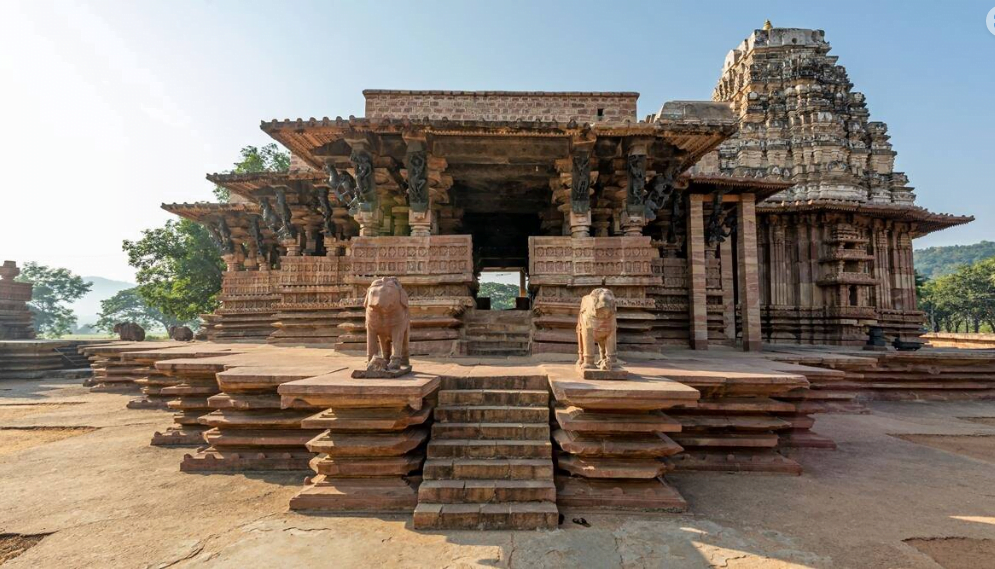
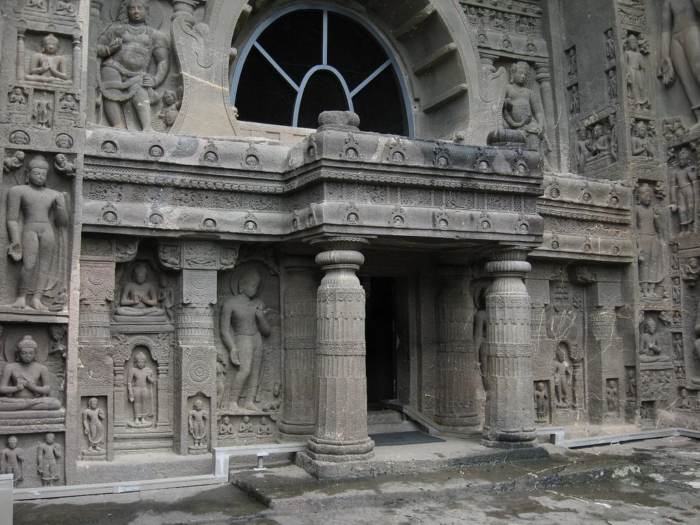
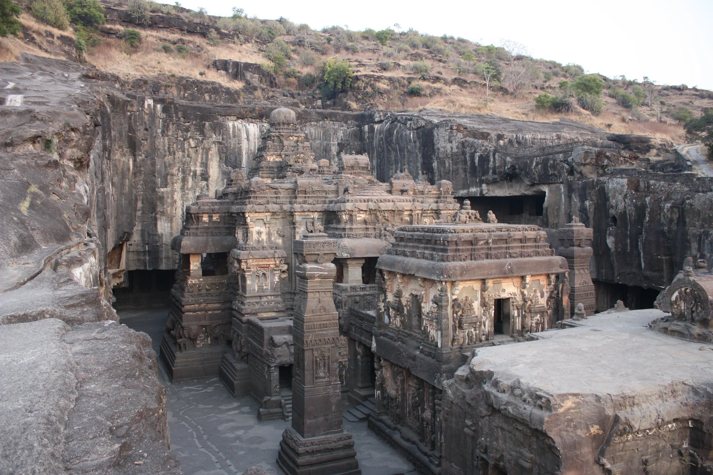
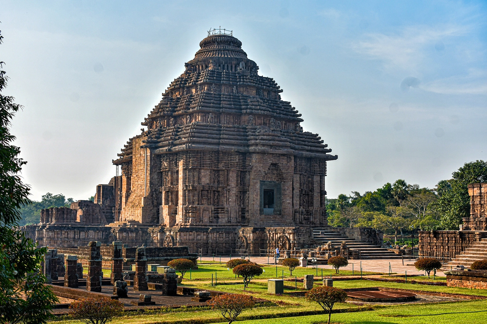
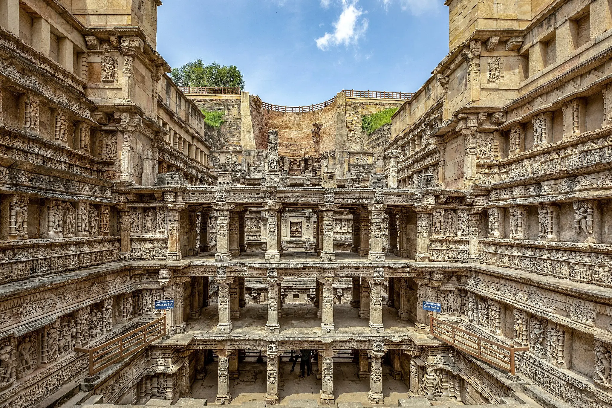
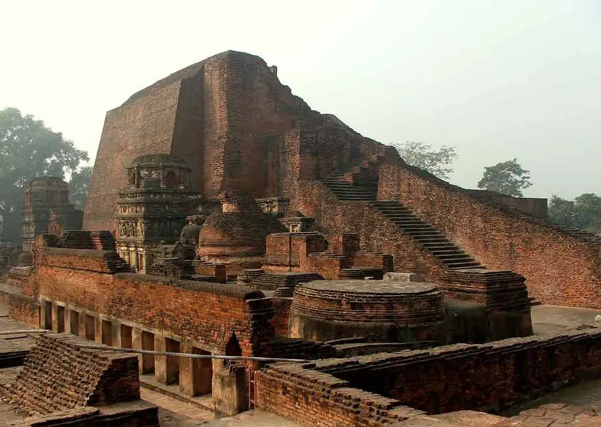
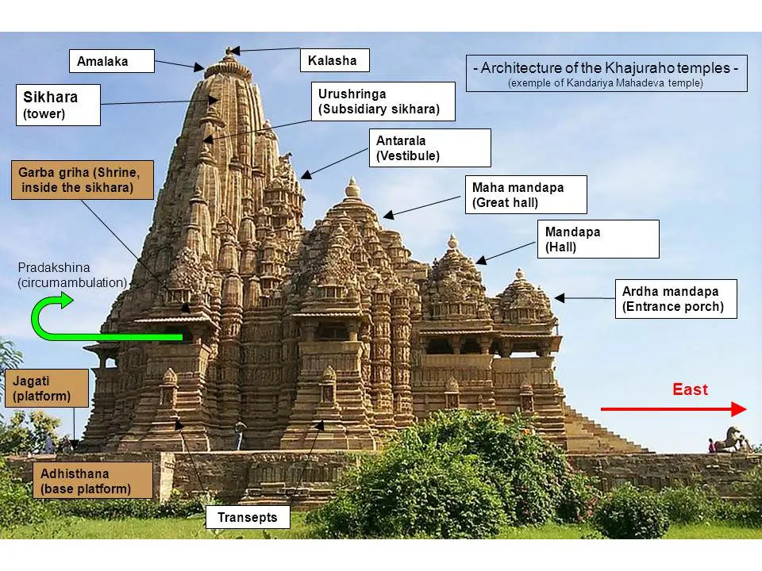
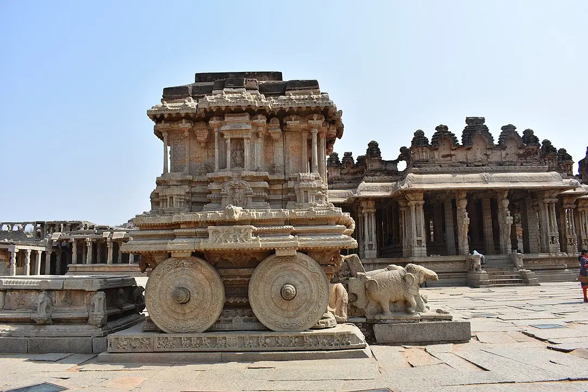
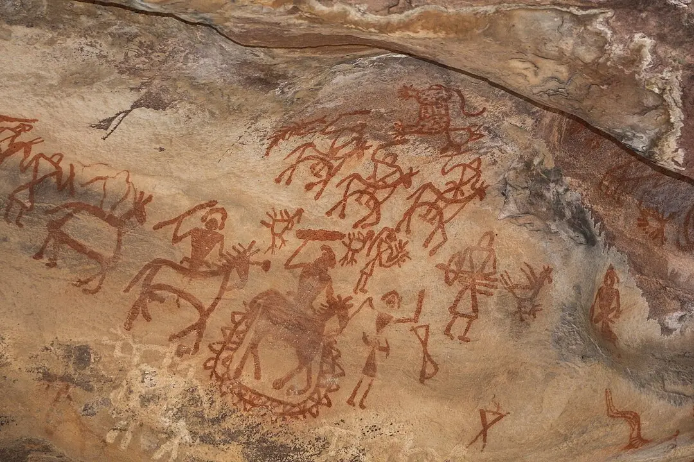

**India** is home to 38 **UNESCO** **World Heritage sites**, which is the sixth-highest number of such sites in the world. In those I choose very unique **10 World Unesco Built Heritage Sites Of India** These sites are of **immense cultural** and **historical significance**, reflecting the country’s rich and **diverse** **history** and **traditions.**

##### **1) Kakatiya Rudreshwara Ramappa Temple, Telangana:**

Said to be the brightest stars in the galaxy in the medieval period of the Deccan region. This 13th-century temple is a remarkable example of the Kakatiya dynasty’s architectural prowess. The temple’s intricate carvings and sculptures, made from lightweight bricks, are a testament to the Kakatiya’s mastery of technology and engineering.

*Kakatiya Rudreshwara Ramappa Temple, Telangana*

The temple is also known for its unique floating brick technique, which allows the temple to remain standing despite earthquakes. The Ramappa Temple is a must-visit destination for history and architecture enthusiasts, offering a glimpse into India’s rich cultural and architectural heritage.

##### **2) Ajanta Caves:**

It is a series of 29 Buddhist cave temples located in Maharashtra, India. These caves were built starting from the 2nd century BCE and were used until the 6th century CE. The caves are famous for their stunning rock-cut sculptures and frescoes, which depict the life and teachings of Buddha, as well as the daily life of people during that period.

*Ajanta Caves*

The caves are a popular tourist destination in India. Visitors are awestruck by the intricate details and the sheer scale of the artwork. which is a testament to the artistic prowess of ancient India.

##### **3) Ellora Caves:**

It is an archaeological site located in Maharashtra, India. This complex of 34 monasteries and temples was built between the 6th and 10th centuries CE and is famous for its rock-cut architecture, sculptures, and artworks. The caves are a unique blend of Hindu. Buddhist, and Jain cultures, showcase the religious harmony that existed in ancient India.

*ellora-caves-kailasa-temple_1*

The most famous cave is the Kailasha Temple, a stunning masterpiece carved out of a single rock. The Ellora Caves are a must-visit destination for history and art lovers.

##### **4) Sun Temple, Konark Odisha:**

It was built in the 13th century and is dedicated to the Hindu sun god, Surya. The temple’s architecture is unique and impressive, with intricate carvings and sculptures depicting various mythological stories. The temple is designed in the shape of a chariot with twelve wheels, pulled by seven horses, and is a symbol of the sun god’s journey across the sky.

*Konarka_Temple*

The temple is a popular tourist attraction, drawing visitors from all over the world to marvel at its architectural and artistic beauty.

##### **5) Rani ki Vav, Patan Gujarat:**

*Rani_ki_vav-Patan-Ahmedabad*

Also known as the Queen’s Stepwell is located in Patan, Gujarat. Built-in the 11th century, it is a magnificent example of Indian Stepwell architecture. The stepwell is intricately carved with sculptures of gods, and goddesses. and mythological creatures. The carvings on the walls depict scenes from the life of Lord Vishnu and his ten incarnations. The stepwell is also a feat of engineering, with seven levels of stairs leading to the water source. Today, Rani ki Vav is a popular tourist destination and a symbol of India’s rich cultural heritage.

##### **6) Nalandsha Viwavidyalaya, Nalanda Bihar:**

*Nalanda University, bihar india*

[Photo by: Wonderlane for fliker.com](https://www.flickr.com/photos/wonderlane/3946578949) 

It comes across as the largest university in the entire world, ages ago. It dates back to the 5th century AD. It was a centre of learning for philosophy, mathematics, astronomy, medicine, etc. The university attracted scholars from all over the world and was a symbol of India’s intellectual and cultural heritage. Today, the university’s ruins showcase ancient India’s impressive architecture and engineering skills. Visiting the site provides insight into the history and evolution of education in India and is a must-visit for history and art enthusiasts.

##### **7) Khajuraho Group of Monuments, Madhya Pradesh:**

*Khajuraho-of-Hindu-architecture Madhya Pradesh, India*

Photo by: Wikimedia 

The site consists of a group of Hindu and Jain temples built during the Chandela dynasty in the 10th and 11th centuries. The temples are famous for their intricate carvings depicting various aspects of life, including love, war, and spirituality. The erotic sculptures in some of the temples have also gained international attention. The Khajuraho Group of Monuments is a testament to India’s rich cultural and architectural heritage and is a must-visit for anyone interested in history, art, and culture.

##### **8) Group of Monuments of Hampi, Karnataka:**

*Group_of_monuments_at_Hampi_karnataka.*

It comprises the ruins of the ancient city of Vijayanagara, which was once the capital of the Vijayanagara Empire. The site includes over 1,600 surviving remains of temples. palaces, and other structures, showcasing the empire’s architectural and engineering skills. The site is also significant for its historical and religious importance, as it was a centre of Hindu culture and learning during the 14th to 16th centuries. It attracts tourists from all over the world for its unique blend of history and art.

##### **9) Rock Shelters of Bhimbetka, Bhopal Madhya Pradesh:**

*Rock_Shelter_Bhimbetka*

The site consists of seven hills and over 700 rock shelters, with evidence of human occupation dating back to the Paleolithic era. The rock art found here is some of the earliest known in the world, depicting hunting scenes, daily life, and religious beliefs of the ancient inhabitants. The site is a testament to the rich cultural heritage of India and a must-visit destination for history and art enthusiasts.

##### **10) Dholavira: A Harappan city, Gujarat:**

Dholavira is one of the five largest Harappan cities in India. that dates back to the Bronze Age. Located in Gujarat, it is renowned for its impressive urban planning, intricate water management system, and unique architecture. The city had a thriving economy and was a hub for trade and commerce. Its well-preserved artefacts and structures provide insight into the Harappan civilization’s social, economic, and cultural practices. Dholavira is a must-visit for history enthusiasts and a testament to India’s rich and diverse cultural heritage.

See another interesting article also

[51-Year-old Lonar Mysterious Lake and Daitya Sudan mandir](/1300-year-old-daitya-sudan-mandir-lonar/)
