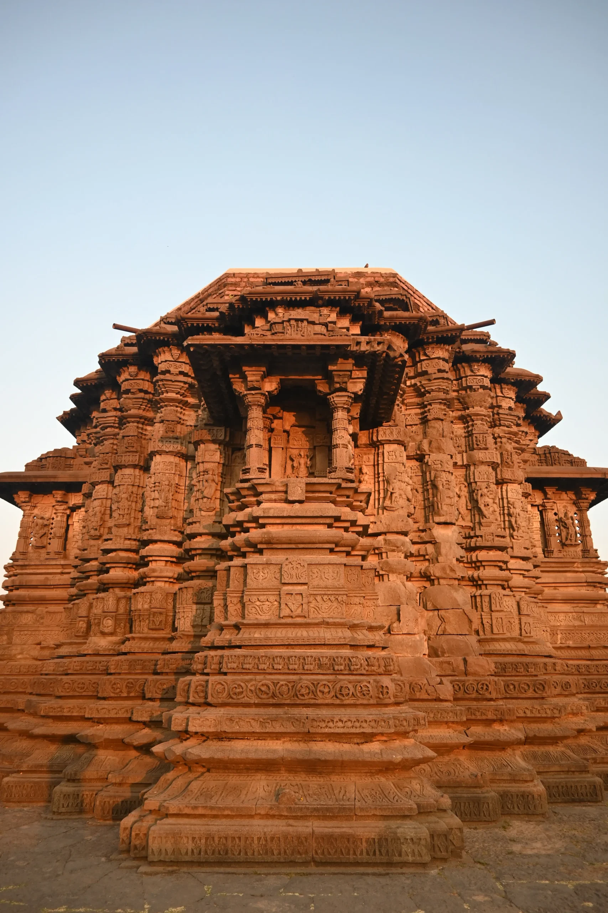

Going to **1300+ Years Old Daitya Sudan Mandir Lonar,** one has to descend from a height by a path… this road is breezy and passes through the forest. A short distance on the side of this trail, a little higher up on the left side, there is a wonderful and unique temple of Shri Rama. Ruined and largely neglected, the temple still stands as a testimony to its ancient grandeur and opulence.

The extravagant feature of this temple is that there is only an idol of **Lord Rama** in this temple, usually there is never an idol of Lord Rama alone. On one side of Sri Rama stands brother Lakshmana, and on the other side his wife Sita. What is more special is that this idol of Shri Ram is unarmed and this is unique. A bow and arrow is always shown in Sri Rama’s hand which is not present in this idol.

*Old Daitya Sudan Mandir Lonar*

There is a particular reason behind this. While Shri Ram was in exile, he got the news of his father Dasharatha’s death while he was staying here on the side of this lake. Sri Ram performed his father’s dashakriyavidhi at Mehkar on the banks of the Banganga river, 20 km. from here.  
Shri Ram wanted to perform the “पिंडदान” (pindadaan) of his father and since he was in exile, the condition was that Shri Ram should be unarmed and no one of his own should be with him for the ritual. This पिंडदान (pindadaan)was done by Shri Rama on the side of this lake and the present temple of Nisharam Shri Rama is located in its place.  
A surprising thing in this temple is that when you stand in front of the idol in the heart and join your hands to offer a salutation, you see Lakshman on one side of the idol of Lord Rama and Mother Sita on the other side. It’s pretty amazing. There is a special reason behind it. The temple has twelve beautifully carved stone pillars in the assembly hall, which are installed in the temple in a specific pattern. Four large pillars in the centre of the hall and four smaller pillars on the right side and four on the left side. These pillars are placed in such a way that when we stand in front of the idol with folded hands, the rays of light are reflected from a certain angle and our own shadow falls on the side of the idol of Sri Rama in such a way that we get the impression that Sitamata is standing on one side of the idol and Lakshmana on the other. When I saw this in person, I was thrilled.

Just think, how they could have created this when there were no modern tools like calculators, computers, telescopes, and compasses like today? Ah, and what if the length, width and placement of the pillars are changed by a centimetre or two? It is simply impossible to realize how amazing this thing is. This shows how powerful science was at that time.

Not only this but standing in front of this idol, if you raise both your hands straight above your head and move them left and right as if bye-bye, then on the back wall above the head of Shri Ram, you can see seven shadows of your hands moving like fanning. When I personally experienced both of these types, it was jaw-dropping. Such a special feature is still found in this temple. Think about how learned and highly artistic our ancestors were. How vast was the rock art of that time? It is magnificent beyond your imagination but is literally disappearing with the passage of time.

Oh yes, one more thing, the compass does not work in this temple. There, while sitting down on the ground for rest in the temple, if you remove the compass and place it on different stones, the needle of the compass does not point south-north. When a compass is placed on different stones, the needle wanders but does not point to fixed south and north. Interesting, isn’t it? Of course, there will be a scientific reason behind it. But I’m deeply saddened to see the current state of this temple. However, at the end of the day,

I’m really proud to have such a glorious past.🙏🏻🚩

also, see my other article

[10 World Unesco Built Heritage Sites Of India](/10-world-unesco-built-heritage-sites-of-india/)
