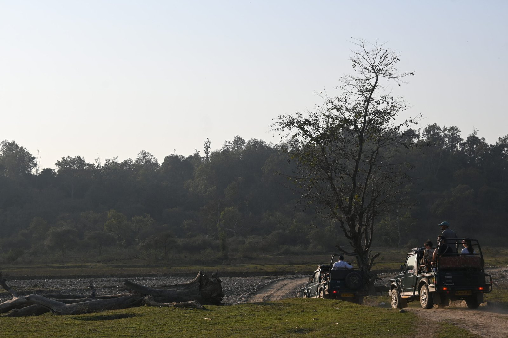
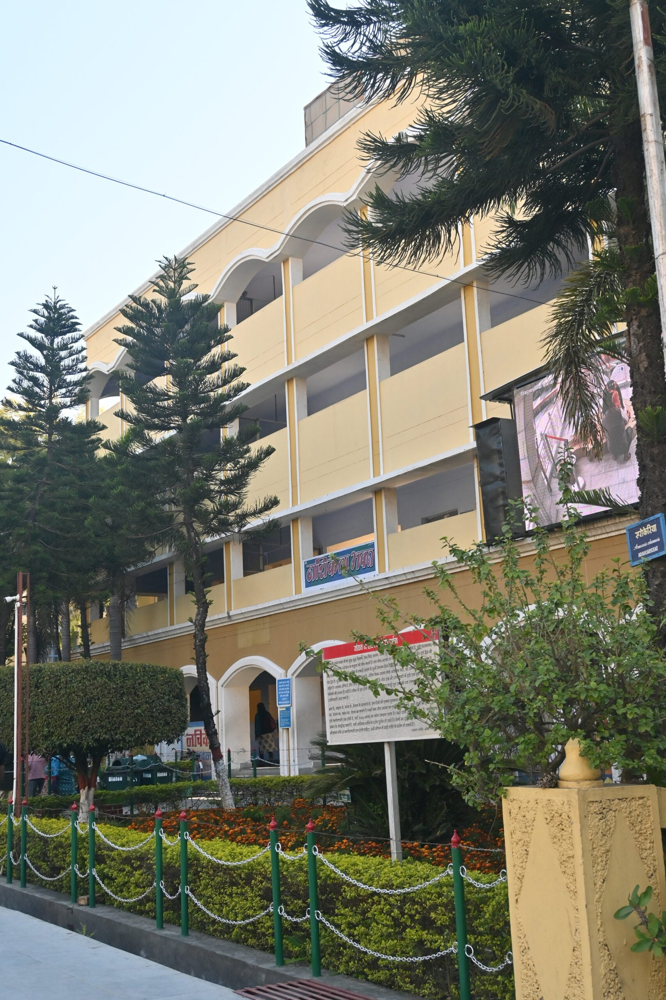
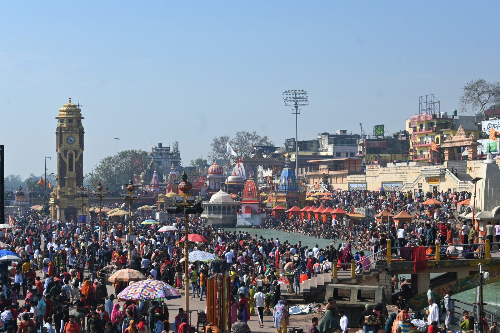
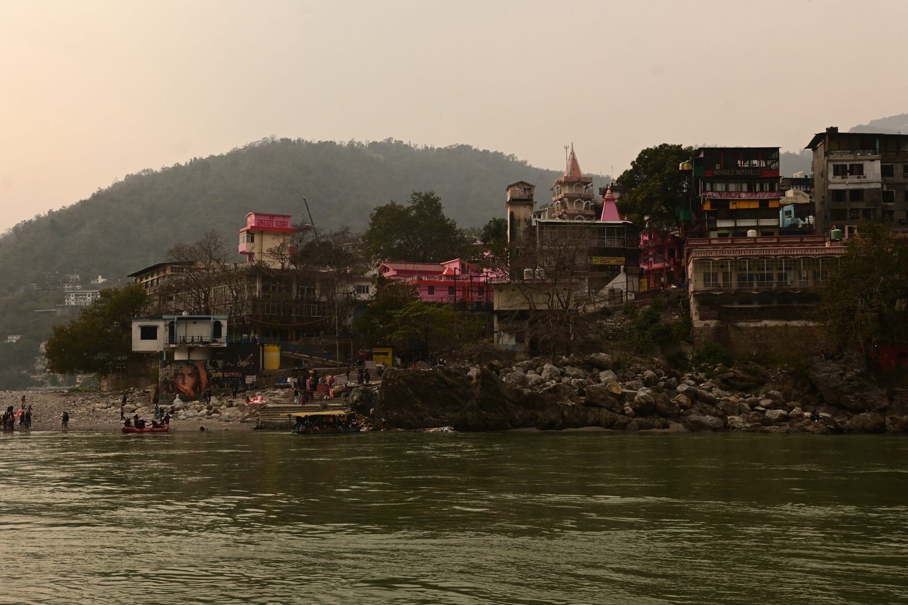
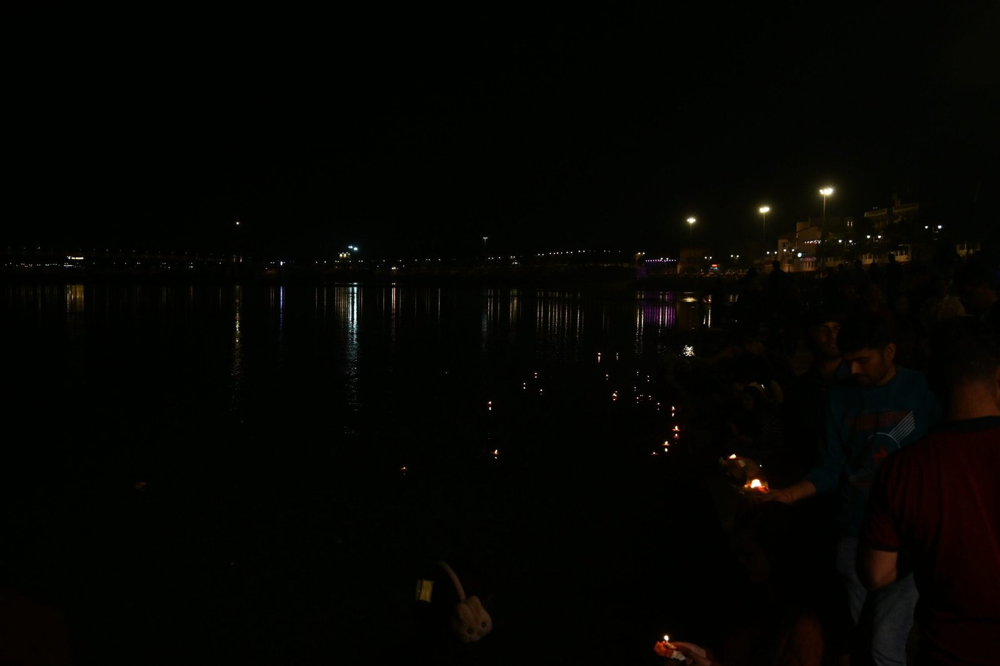
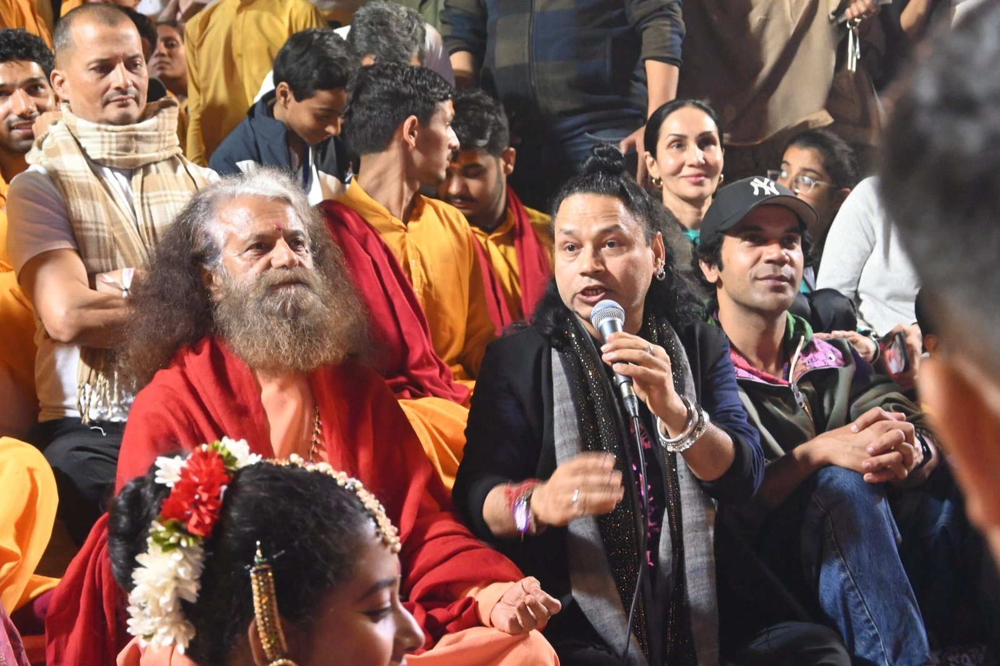

The **2 ethereal days of the Haridwar to Rishikesh trip** started with 6 friends and a train ride from **Gwalior** to **Delhi** in the evening, a route I was familiar with, with views that whizzed by the windows. I was awake throughout the journey because I was thrilled to explore Haridwar and Rishikesh, and the general compartment was too cosy. 

After arriving in Delhi at the crack of dawn, I headed to Safdarjung railway station and then to Akshardham Metro Station to board a FlixBus to Haridwar. The bus provided a comfortable journey, allowing me to catch glimpses of the awakening cities as we sped along the highway. We arrived at Haridwar’s bus stop after a 6-hour journey, filling the air with the fragrance of incense and the faint chimes of distant temple bells. Hiring a local tempo traveller, we went to **Rajaji National Park** (*est. 1983, 820 sq.km.*).

Located in the Shivalik range, it’s a lush haven for wildlife enthusiasts. Known for its diverse flora, dense sal forests and vast grasslands, we witnessed the natural habitat of elephants, tigers, leopards, and over 300 bird species. Rajaji is famous for its elephant population and scenic landscapes. We did an evening safari, which cost us approx. **2000/-** *(subject to change)*. With 6 zones to explore, like **Chilla, and Motichur,** it’s a must-visit for those seeking an immersive experience in nature and wildlife.

As evening descended, I made my way to **Shanti Kunj Gayatri Parivar Ashram**, my place of stay for the night. The ashram, known for its spiritual ambience and community-driven initiatives, offered a peaceful environment. Walking through its premises, I was struck by the sense of harmony that permeated the air. The ashram’s gardens, meditation halls, and simple yet nourishing meals provided a refreshing respite from the day’s travels.

*images by me*

  

The next morning, I visited one of Haridwar’s most revered sites, **Har Ki Pauri**, which translates to “*Footsteps of the Lord*” & is believed to be the spot where Lord Vishnu left his footprint on the banks of the Ganga. There were thousands of pilgrims on the ghats, performing rituals, making offerings, and bathing in the holy river. It is also the location of the evening Ganga Aarti, a ceremony that attracts pilgrims every day. Moreover, every 12 years, millions of worshippers from all over the world assemble at **Har Ki Pauri** for the big spiritual event known as the **Kumbh Mela**. They come to bathe in the holy Ganges, which is said to wash away sins and attain moksha.

*images by me*

After a lovely morning, I took a short ride to **Rishikesh** via Tempo Traveler. **Rishikesh** i.e. the “*Yoga Capital of the World*,”, is a destination that blends spirituality with adventure. The cobbled streets, lined with yoga centres, cafes, and shops selling everything from gemstones to organic clothing, exude a unique charm. Crossing the iconic **Ram Jhula**, I was mesmerized by the sight of the Ganges flowing beneath, with people performing river rafting, its waters shimmering in the afternoon sun. The bridge, bustling with tourists and locals alike, offered panoramic views of the town and the surrounding hills.

*image by me*

I found myself at the hotel after a 10-minute walk. I checked into **Hotel Divya Inn**, which is **0.2 km.** from Laxman Jhula, a cosy yet beautiful accommodation nestled amidst the serenity of Rishikesh. This area is known for its vibrant cafes & offers stunning views of the Ganges. I relaxed in the room for a while and went for cafe-hopping, sampling local delicacies, and browsing through markets filled with antiquities, tapestries, and handmade crafts in the evening.

As the sun began to set, I revisited **Ram Jhula**, this time heading towards **Triveni Ghat** to witness the **Ganga Aarti**, since **Laxman Jhula** was under construction. The atmosphere at **Triveni Ghat** was euphoric, with hundreds gathered to participate in the evening ritual. The aarti, with its synchronised prayers and the soft glow of lamps floating on the river, was a soul-stirring experience.

The very same moment I heard music from the other side of the bridge not knowing that **Kailash Kher** was performing a concert at **Parmarth Niketan**, one of the largest ashrams in Rishikesh. Thus me & my friends ran across the bridge in *slow-mo* like in a Bollywood film to get a glimpse of him. And to my utter surprise, the concert was free! The crowd went bonkers! To top it all off, I caught a glimpse of Bollywood actors **Rajkumar Rao** and **Patralekha**, adding a touch of stardust to an already magical experience.

The music, the band, the dancers and His aura… everything was a treat to my eyes and music to my ears! The soulful environment and spiritual energy were a highlight of the trip!

*Image by myself*

  

It was time to bid farewell to Rishikesh. I felt a deep sense of contentment and a tiny void since the trip had been a perfect blend of spirituality, nature, and culture, offering insights into the timeless wisdom of these sacred towns, and I will be missing them a little too much. The memories of Haridwar and Rishikesh, with their ancient traditions and tranquil beauty, would stay with me long after the journey ends .
