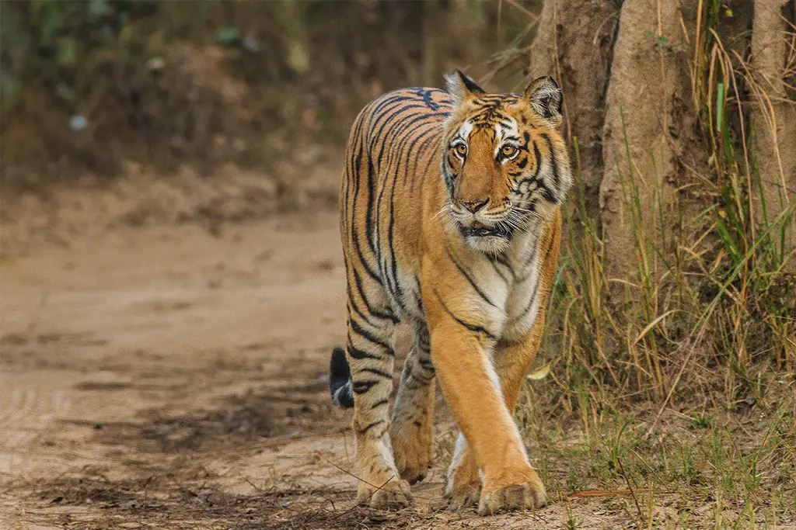
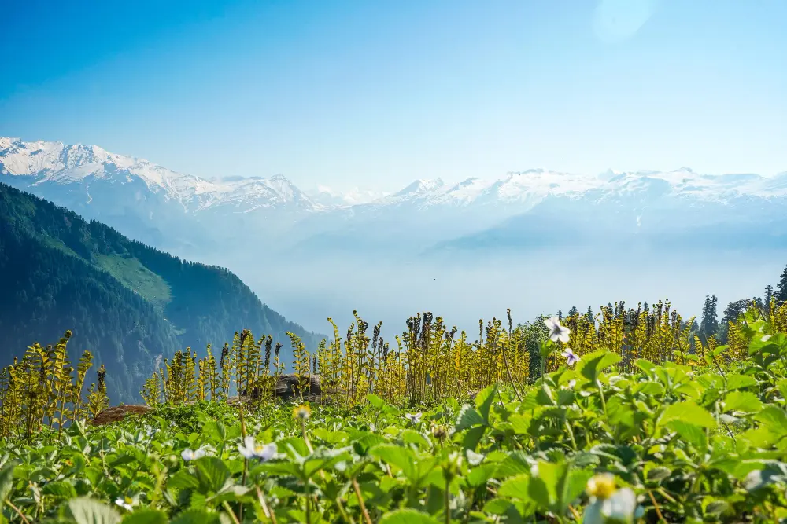
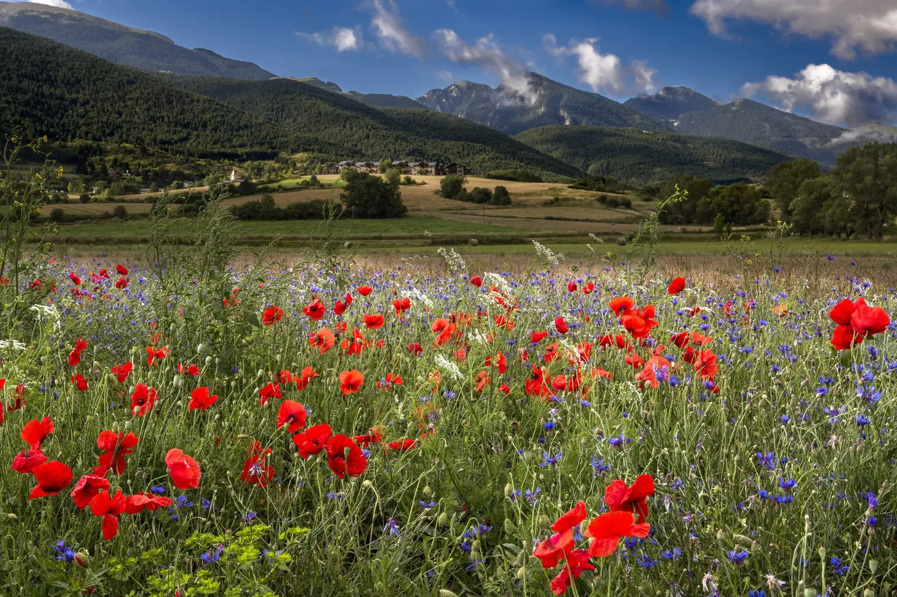
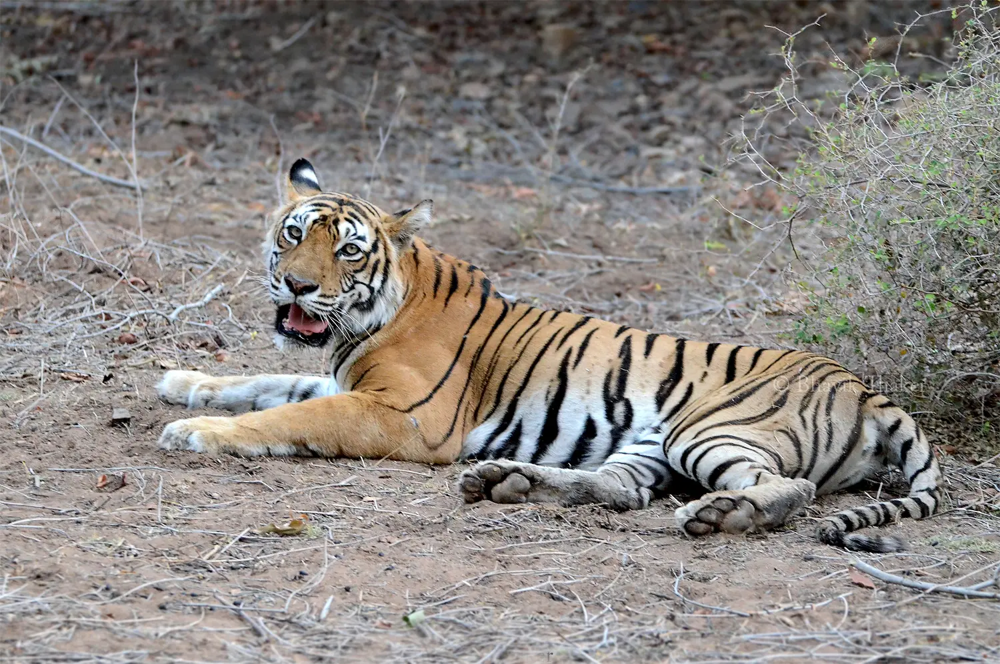
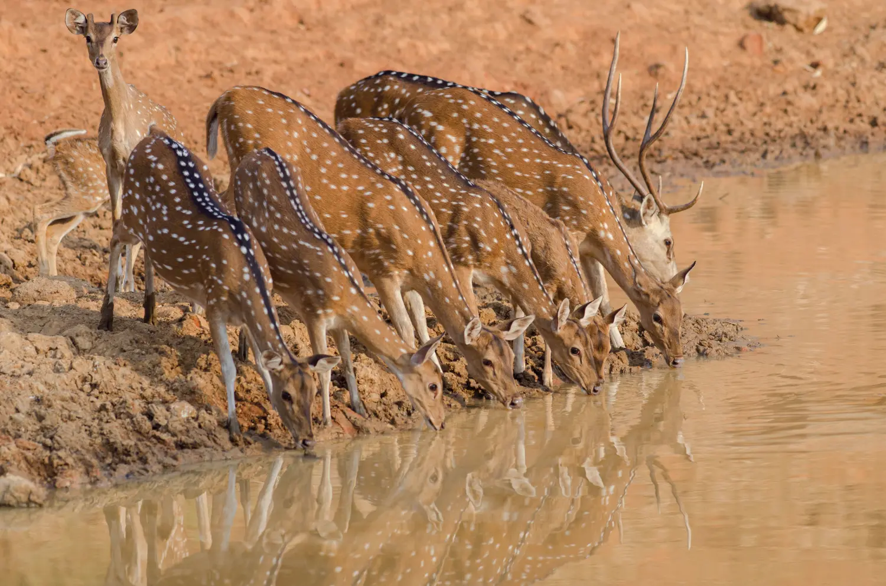

## **5 famous national parks in  
India you shouldn’t miss it!**

India’s untamed life is a mother lode of biodiversity, enhanced by its various national parks. These safe havens cover a huge range of verdure, offering a brief look into the country’s normal wonder. When it comes to definition, a **national park** implies an area that is exclusively designated by the government for the conservation of wildlife and biodiversity due to its natural, cultural, and historical significance.

From the superb Bengal tiger in Ranthambore to the subtle snow panther in Hemis, India’s national parks harbor a portion of the world’s most exquisite species. Seeing crowds of elephants & one-horned rhinos at Kaziranga, and the Asiatic lions of Gir is a sensational encounter. Each park flaunts interesting environments, giving shelter to jeopardized species and guaranteeing biological equilibrium. India’s public parks are a demonstration of the nation’s commitment to protecting its wildlife legacy.

#### **Jim Corbett National Park, Uttarakhand:**

*5 Rich National Parks of India*

This blog would be incomplete without me telling you about India’s first national park, Jim Corbett National Park. It is named after the **legendary naturalist and conservationist Jim Corbett**. Honored as the place where **Project Tiger** was **1st** launched in **1973**, this national park is located at the Himalayas’ foothills, near the popular hill station of Nainital.

Spread over **1318.54 sq. km.**, of which **520 sq. km.** is the main area, and the remaining is buffer it is **260 km.** from Delhi with Ramnagar being the nearest city to reach there.

**Flora:** More than **600 species** of trees, shrubs, herbs, bamboo, grasses, climbers, and ferns.

**Fauna:** It is famous for being home to a large number of tigers, sambar deer, hog deer and chital, sloth and Himalayan black bears, Indian grey mongoose, otters, yellow-throated martens, Himalayan goral, Indian pangolins, and langur.

#### **Great Himalayan National Park, Himachal Pradesh:**

*Great Himalayan National Park, Himachal Pradesh:*

Recognized as a national park in **1999\.** It is spread over an area of **1171 km****.** in Samshi & is **30 km.** away from Kullu. **375** fauna species, including almost **31** mammals, **181** birds, **3** reptiles, **9** amphibians, and **127** insects this park was added to the **UNESCO list of World Heritage Sites** in *June 2014.*

**Fauna:**

-   Blue sheep
-   Snow leopard
-   Himalayan brown bear
-   Himalayan Tahr
-   Musk deer

And **3 of the world’s threatened bird species**

-   Western tragopan
-   koklass
-   cheer pheasants

**Flora:**

Lofty pines & spruces, horse chestnuts, alpine herbs & junipers of the lower valleys, and 3 varieties of oak include:

-   Ban
-   Mohru
-   Kharsu

#### **Valley of Flowers National Park, Uttarakhand :**

*Valley of Flowers National Park, Uttarakhand*

Established in **1982**, it is located in Chamoli in Uttarakhand, the nearest town to visit this destination is Joshimath in Garhwal which is well connected to Dehradun & Haridwar. Known for its meadows of alpine flowers and the variety of flora, it is about **8 km long** and **2 km wide** that comes under **Nanda Devi National Park** **Reserve** **& is in the UNESCO** **World Network of Biosphere Reserves.**

**Fauna:** This richly diverse area is also home to rare and endangered animals like:

-   Asiatic black bear
-   Snow leopard
-   Musk deer
-   Brown bear
-   Red fox
-   Blue sheep

Birds found in the park include Himalayan pheasant and other high-altitude birds like:

-   Himalayan Monal (Lophophorus impejanus)
-   Snow Partridge (Lerwa lerwa)
-   Golden Eagle (Aquila chrysaetos)
-   Himalayan Snowcock (Tetraogallus himalayensis)
-   Himalayan Griffon Vulture (Gyps himalayensis)
-   Snow Pigeon (Columba leuconota)

#### **Ranthambore National Park:**

This is the **Biggest Wildlife Sanctuary in India (1334 sq. km).** It was declared one of the Project Tiger reserves in **1973** and became a national park on 1 November **1980.**  Located **130** **km.** away from Jaipur, this national park has the largest water body called Padam Talao.

Ranthambore National Park has always been in the news for its infamous and majestic **tigress Machli!** This tigress was crowned with various titles like *Queen Mother of Tigers*, *Tigress Queen of Ranthambore*, *Lady of the Lakes*, and *Crocodile Killer*. She was responsible for the recovery of the tiger population and is recognized as **India’s most well-known and most captured tigress.** She is considered the most established living tigress in the wild (20 years of age).

*5 Rich National Parks of India*

**Flora:** The sanctuary is home to a wide variety of trees like

-   Dhok (Anogeissus pendula)
-   Acacia
-   Babul (Acacia nilotica)
-   Kadam (Anthocephalus chinensis) as well as ***one of the largest banyan trees in India.***

***Fauna:***

-   Bengal Tiger
-   Indian leopard
-   Indian elephant
-   Wild water buffalo
-   Gaur
-   Nilgai
-   Barasingha
-   Blackbuck
-   Chinkara
-   Chousingha
-   Wild boar
-   Sambar
-   Indian muntjac
-   Indian hog deer
-   Spotted deer
-   Striped hyena.

#### **Keoladeo National Park, Rajasthan:**

*Keoladeo National Park, Rajasthan*

Also known as **Bharatpur Bird Sanctuary**, is a renowned avian paradise spanning over **29 sq. km.** It is recorded as a World Legacy Site by **UNESCO in 1985**. It gets its name from the ancient Keoladeo Temple dedicated to Lord Shiva, situated within its premises.

Keoladeo offers a unique ecosystem of wetlands, marshes, and shallow lakes, making it a vital breeding and wintering ground for a diverse variety of migratory birds. Every year, several birds from as far as Siberia, Central Asia, and Europe migrate here during the winter months, adding to the rich diversity of resident bird species.

**Fauna:** The park is home to over **370 species** of birds and animals such as the basking python, painted storks, deer, nilgai, and more. It is the only region in India where the critically endangered Siberian Crane can be spotted during the winter.

Some of the birds which you can expect to spot here are:

-   Cranes
-   Pelicans
-   Eagles
-   Wagtail
-   Spotted bill duck
-   White-breasted kingfisher
-   Moor hen
-   Painted stork
-   Partridge
-   Magpie robin
-   Honey-buzzard
-   Rose-ringed parakeet
-   Green-footed yellow pigeon, etc.

Folks, from the majestic roar of tigers to the soaring flight of eagles, each national park narrates a unique story of life’s resilience. As every leaf rustles and each creature roams freely, every Indian should feel proud of these national parks; for they’re not just protected lands but a natural legacy. Let us take pride in preserving these sanctuaries, safeguarding our nation’s natural heritage for generations to come. you must visit these 5 famous national parks in India

photo courtesy: Freepik.com
