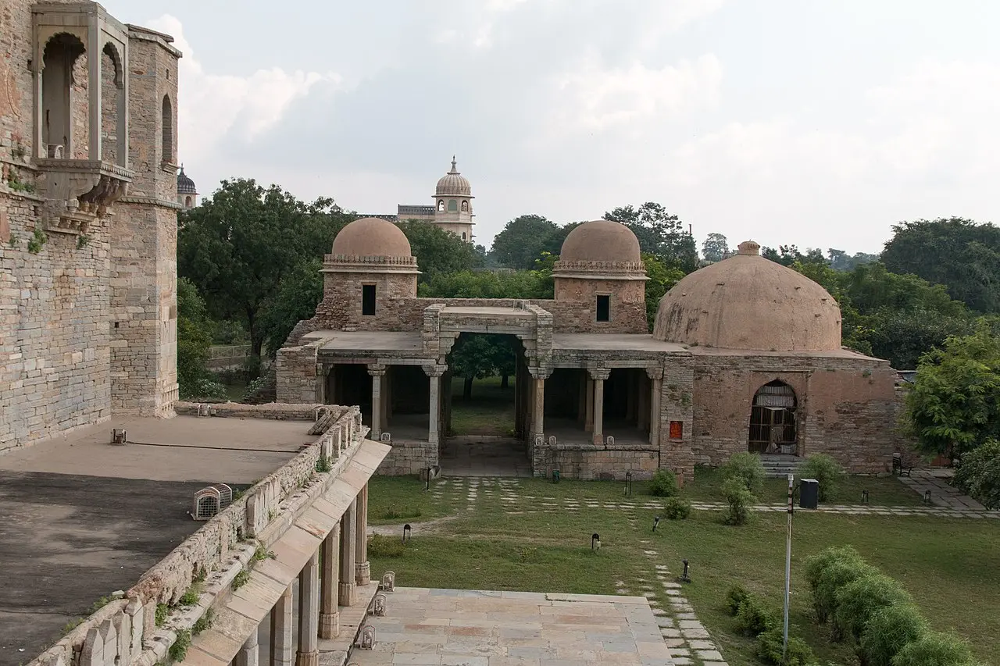
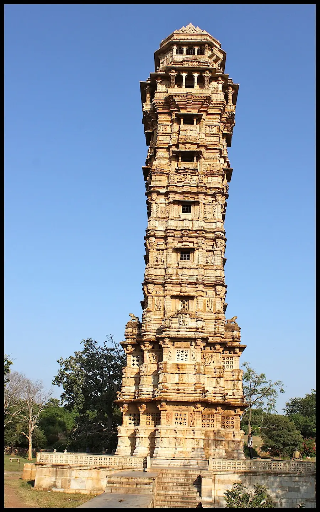

Step into this ancient city, where history unfolds at every turn. This storied land has been a witness to great kings like **Rana Sangha, Maharana Pratap, Moris, Rawals, Kumbhas**, and the great **Meerabai**. It was found by Chitranga Mori in the 5th century and was captured by Bappa Rawal in the 8th century. This place with 113 temples has suffered 27 attacks out of which 24 were won during the era of **Maharana Pratap**. Additionally, when the son of Khilji ruled here it was renamed “**Khijrabad**“.

## Here’s a list of places in Chittorgarh: Redefining Heritage in the 21st Century

### **Rana Kumbha Palace:**

*Rana Kumbha palace chittorgarh*

**Rana Kumbha** Palace is a historic palace located near **Vijay Stambh** inside the Chittorgarh Fort Complex. It is one of the most popular tourist attractions in Chittorgarh Fort. Maharana Kumbha reconstructed the palace on top of a wrecked palace established by Bappa Rawal in 734 AD. In Rajasthan’s Mewar dynasty, he was noted for his art and cultural support. Rajput King Maharana Kumbha spent his princely life at this palace. The destroyed Kumbha Palace is the largest structure in Chittor’s fort.

### **Kumbh Sham Temple:**

Constructed in the 8th century by Rajput king Bappa Rawal, this temple is 1200 years old and is dedicated to the Varah avatar of lord Vishnu. Subsequently, in the 14th century, it was renamed Kumbh Sham Temple. The temple has Indo-Aryan architectural influence and parts of the temples are inspired by Somnath and Konark temples.

### **Meerabai- Krishna Temple:**

It is the very temple where Meerabai worshipped beloved Lord Krishna. Meera Bai was a Rajput princess who was also a poetess and a saint. The princess had given up her opulent lifestyle to devote her life to Lord Krishna’s worship. The Meera temple was built in her honor and is a well-known Hindu temple that you must see during your trip to Rajasthan.

### **Vijaystambh (1440-1448 AD):**

*Vijay Stambh Chittorgarh Redefining Heritage in the 21st Century*

image source:- Kandukuru Nagarjun for flickr.com

Created by Maharana Kumbha, this symbol of victory is also called ***“Mewar ki Shaan”.*** It commemorates the defeat of Mughal rulers Mahmud & Ahmed Shah by the armies of Gujrat & Malwa. It is dedicated to Lord Vishnu. With 37 m. height, 157 steps, intricate carvings of Hindu gods and goddesses, 9 pillars representing ***“navgraha”*** and inter-lock systems made out of stones are the salient features of Vijaystambh. The creators Jaita, Punja, and Paima took about 8 years & wealth worth rupees 90 lakhs to create the entire marvel inspired by Shivji’s ***“damru”.***

### **Kirtistambh:**

It was erected by the Jains in the 11th century, specifically by Shreth Gija, and is primarily dedicated to the Digambara clan of the Jain community. Standing at a height of 25 m, this 7-story structure took 8 years to come to its full shape and valeur.

### **Gomukh Reservoir:**

It’s the only natural source of water that is perennial in nature in the entire Chittorgarh. Various tourists take a dip in it & worship the idols near the source. Besides, there is a small shrine that has created an imaginary idol, Queen Padmini. The legend has it that she used to bathe here accompanied by her fellow servants. One can also buy some snacks for the fish in the water and enjoy the top view.

### **Samadhishwar Temple:**

Old by a millennium, this temple is home to the 09 ft. tall indispensable trinity of the Hindu belief, i.e., Brahma, Vishnu, and Mahesh carved out of one single stone (monolithic structure). It was attacked by Khilji which was restored by King Kumbha’s father.

### **Jauhar Kund:**

The place where the 1st Jauhar of Chittorgarh was committed by Queen Padmini & 16,000 others to save their honor. Jauhar was performed by women & children to prevent enslavement, captivity & rape by invaders during the conflict. These mass suicides were mostly carried out by women from royal families in order to defend & preserve their dignity. Today, this 40 ft. deep kund is developed into a garden by ASI and made a ***“havan kund”*** where the royal families come to pay respects.

### **Padmini Palace:**

Made in the 13th century, this 3-story palace was created for Queen Padmini, by King Maharana Rawal Ratan Singh. He also developed a man-made lake for his beloved wife along with a summer palace. This is said to be the very place where Alauddin Khilji saw the mesmerizing mirror image of the beautiful Rani Padmini, for the very 1st time. The palace was later reconstructed in the 19th century.

### **Mewar National Handloom:**

This 45-year-old shop offers some of the most unique range of sarees beautifully handcrafted by various skilled laborers with a traditional method who’ve been in this biz for generations together. Sarees fabricated with lotus stems, rose petals, and the peelings of custard apples are major here. Apart from clothing and bedding products, tourists can purchase sterling silver jewelry, perfumes, eatables, etc. So, don’t hesitate to buy some souvenirs here!

Chittorgarh with its indomitable spirit, continues to redefine its heritage in the 21st century, welcoming visitors with open arms to explore its captivating past and vibrant present. Get ready to be enchanted by the stories, culture, and craftsmanship that make this city timeless
