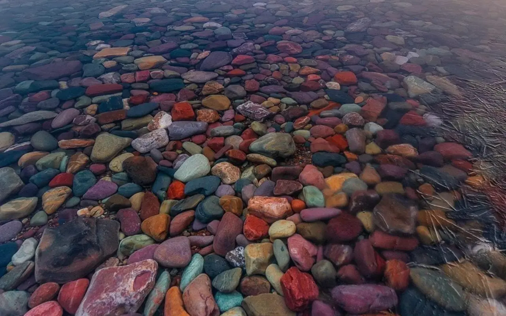

###### **Introduction:**  
**Glacier National Park: Nature’s Majestic Wonderland** is Nestled amidst the rugged peaks of the Rocky Mountains in Montana, Glacier National Park: Nature’s Majestic Wonderland stands as a testament to the raw beauty of nature. Established in 1910, this iconic national park is a sanctuary for wilderness enthusiasts, adventure seekers, and nature lovers. Spanning over 1,500 square miles, Glacier National Park is a treasure trove of natural wonders, diverse wildlife, and breathtaking landscapes.

**Historical Background:**  
Glacier National Park holds great historical significance, once being home to Native American tribes like the Blackfeet, Salish, and Kootenai. It also served as a vital corridor for early explorers and pioneers in the 19th century. The park’s name was derived from the ancient glaciers that carved the awe-inspiring landscapes that we see today.

###### **Famous Animals to Spot:**  
One of the most thrilling aspects of visiting Glacier National Park is the opportunity to encounter its diverse wildlife. Keep your eyes peeled for the majestic grizzly bear, elusive mountain goats scaling sheer cliffs, nimble-footed bighorn sheep, and the iconic American bison. Visitors may also catch glimpses of wolves, moose, cougars, and bald eagles soaring across the clear blue skies.

###### **Tourism and Peculiarities:**  
Each year, Glacier National Park attracts millions of visitors from around the world who come to witness its unmatched beauty. From hikers conquering the rugged trails to photographers capturing stunning landscapes, the park offers experiences to suit every traveller. Its most famous feature is the Going-to-the-Sun Road, a 50-mile marvel that traverses the heart of the park and provides breathtaking vistas at every turn.

###### **Flora and Fauna:**  
Glacier National Park boasts a rich and diverse ecosystem, supporting a wide array of plant and animal life. The park is renowned for its old-growth forests of western red cedar, Douglas fir, and Engelmann spruce. Wildflowers adorn the meadows during the summer months, creating a vibrant tapestry of colour. It is also home to more than 700 miles of hiking trails, allowing visitors to immerse themselves in the untouched beauty of nature.

*Glacier National Park: Nature’s Majestic Wonderland*

###### **Famous Celebrities Who Visited:**  
Over the years, Glacier National Park has captivated the hearts of many notable figures. Renowned naturalists John Muir and President Franklin D. Roosevelt were among the early enthusiasts who recognized the park’s significance. Notable celebrities, including Leonardo DiCaprio, Reese Witherspoon, and Oprah Winfrey, have also experienced the wonders of this national treasure.

###### **Why Visit Glacier National Park:**  
Glacier National Park offers a truly unparalleled experience for nature lovers and adventurers alike. Whether you’re an avid hiker seeking breathtaking vistas, a wildlife enthusiast yearning for close encounters with magnificent creatures, or simply looking for a place of serene beauty, Glacier National Park has something to offer. Its pristine landscapes, crystal-clear alpine lakes, and snow-capped peaks create an atmosphere of tranquillity that is hard to replicate elsewhere.

###### **Conclusion:**  
Glacier National Park: Nature’s Majestic Wonderland is a testament to the sublime wonders of nature. With its rich history, diverse wildlife, and unparalleled natural beauty, it stands as a beacon for those seeking an escape into the heart of the wilderness. Whether you’re scaling a mountain peak, capturing the perfect photograph, or simply revelling in the stillness of the park, Glacier National Park will leave an indelible mark on your soul, reminding you of the beauty and grandeur that exists in the world.

See also :[https://gauritheexplorer.com/exploring-the-wonders-of-satpura-tiger-reserve/](/exploring-the-wonders-of-satpura-tiger-reserve/)
