## Why visit Keoladeo National Park?

Welcome to yet another nature wonder, Keoladeo National Park! Located in Bharatpur, covering 29  sq. km. area it is recognized worldwide as one of the biggest breeding & feeding grounds for all the migratory birds from Central Asia, Siberia, and Europe. Rajasthan’s this bird’s abode is a luxury from October to March especially for birds like the Siberian crane, painted stork & bar-headed goose. Used as a hunting ground by the Maharajas and colonizers thousands of birds were shot every day in this bird’s paradise during 1850’s. Fortunately, due to the efforts of the infamous ornithologist Salim Ali, local authorities and others, the national park was declared a UNESCO World Heritage Site in 1985 & is a designated as Ramsar site in 1981.

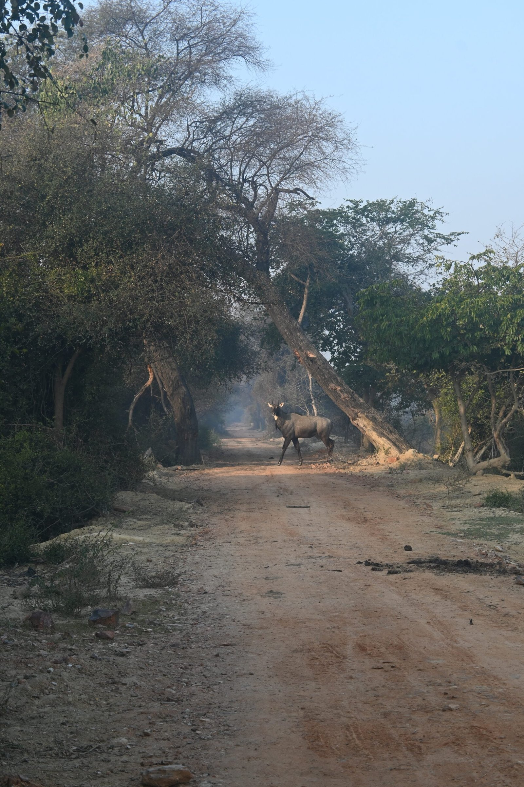

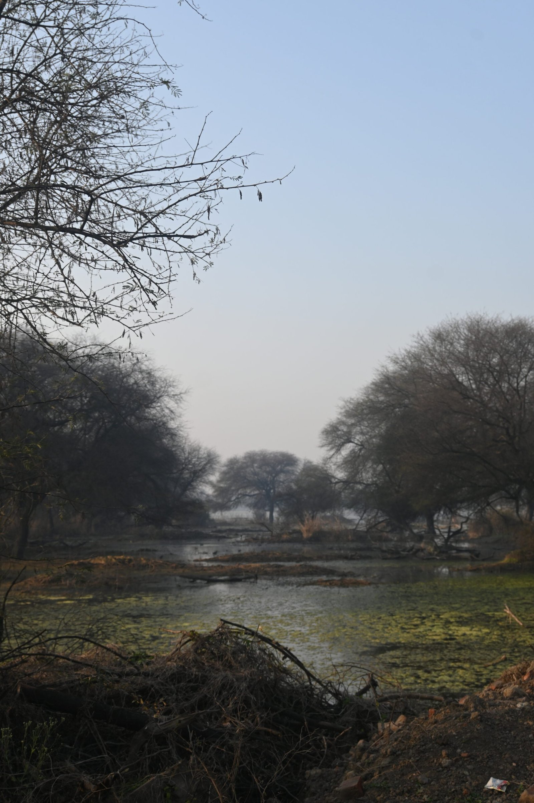

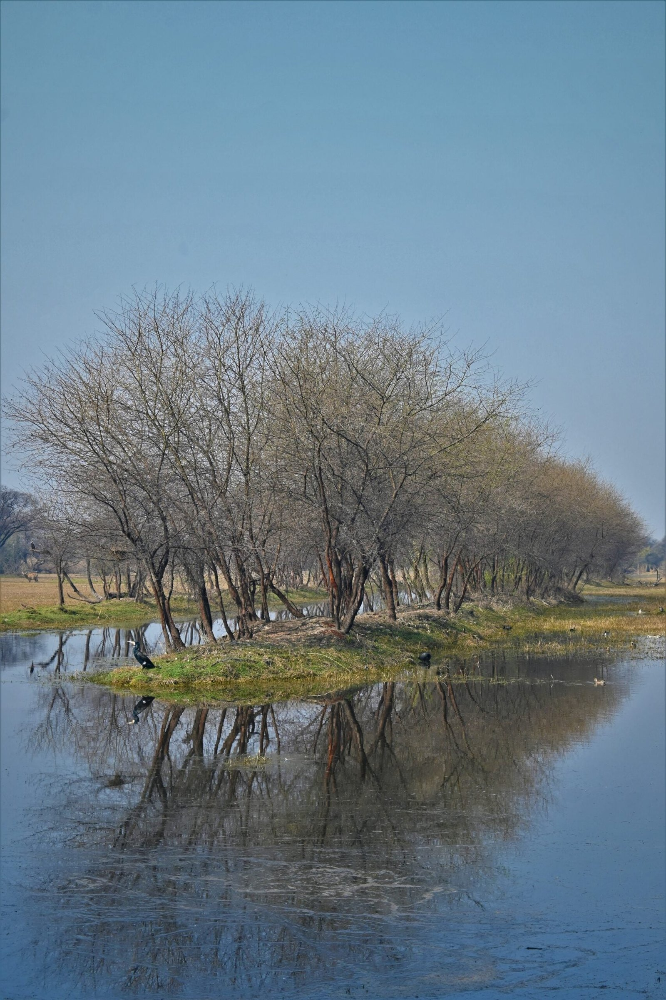

### **How to Reach Keoladeo National Park?**

1.  #### **By Air:**
    

**Nearest Airport:** Agra Airport & Jaipur International Airport (56 km. & 187 km. away respectively). Hire a taxi/take a bus to reach Bharatpur.

2.  #### **By Train:**
    

**Nearest Railway Station:** Bharatpur Junction (5 km away).  One can get autorickshaws and taxis from the station to take you to the park.

3.  #### **By Road:**
    

**From Delhi (220 km. *approx.*):** You can drive via the **Yamuna Expressway** and **Agra-Bharatpur** route. Takes around ***4-5 hours***.

**From Agra (56 km. *approx.*):** Easily accessible via the **NH21**. Takes about ***1.5 hours**.*

**From Jaipur (187 km. *approx.*):** One can reach within ***3-4 hours*** via **NH21**.

**(***I drove from Gwalior, 130 km. approx. via NH44)*

4.  #### **By Bus:**
    

**State-Run and Private Buses:** Regular buses run from major cities like Delhi, Agra, and Jaipur to Bharatpur. The bus stand is near the railway station, about **5 km** from the park.

5.  #### **By Taxi/Car Rental:**
    

**(***I hired a car rental service from Gwalior, costed around 1700/- per pax.)*

Renting cars from cities like Agra, Delhi, or Jaipur or hiring a taxi is the perfect option for a flexible journey. Local transport substitutes such as autorickshaws and cycle rickshaws take you to the park’s entrance, once reached.

### **Where to stay?**

I stayed at a wonderful and comfortable homestay called Spoonbill which is just 1 km. away from the national park. It was a one-night stay and the host Renu Ma’am was very kind and hospitable. I would highly recommend everyone to book local homestays or guest houses, to get a more authentic and surreal experience since they’re all run by local families for years now and prove to be budget-friendly for shorter trips as well.

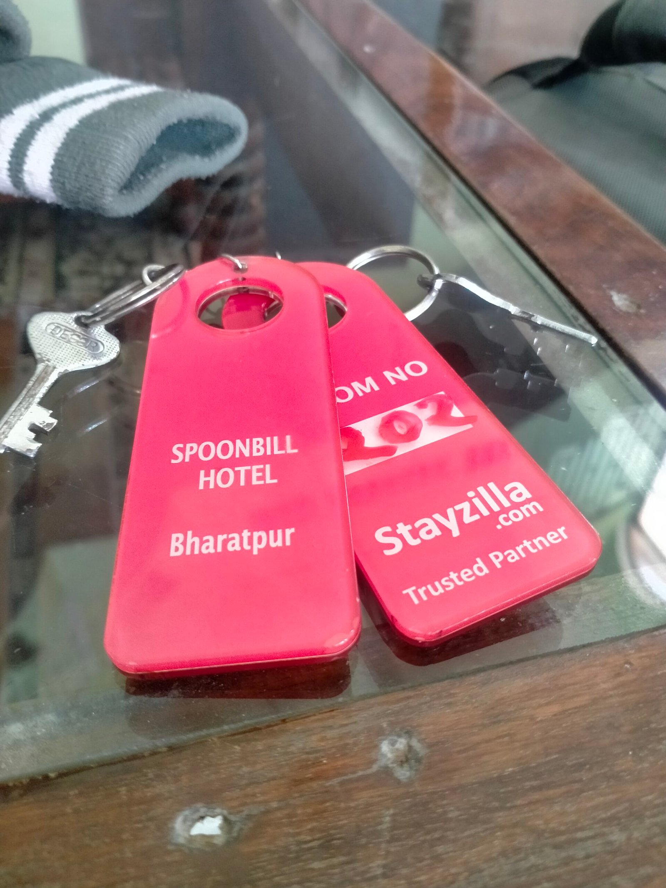

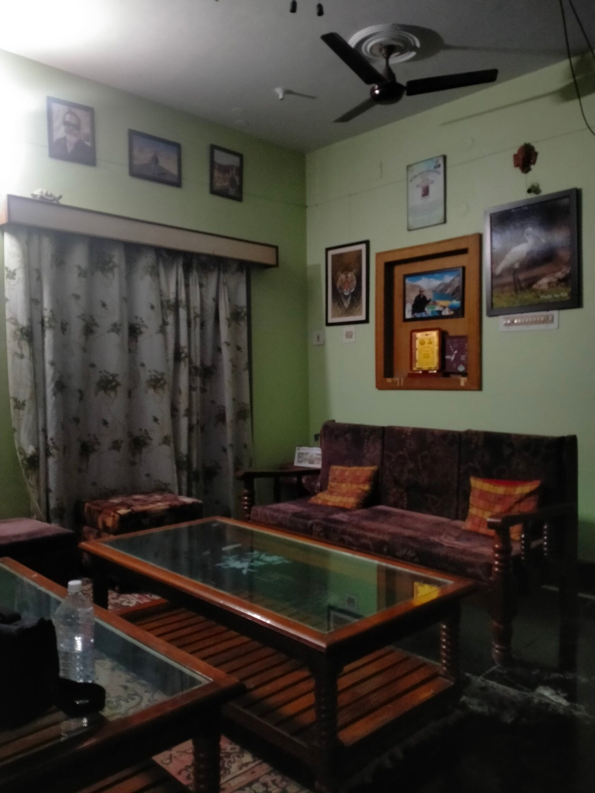

*Photo 2: Living room photo 3: Bookshelf*

### **What to see at Keoladeo National Park?**

#### **1\. Avifauna:**

**A total of 370 species** of birds are found in Keoladeo National Park. This includes a critically endangered species called the Siberian Crane, who is a regular visitor.

-   **Painted Stork**
-   **European Roller**
-   **Blue Tailed Bee-eater**
-   **Black Cormorant**
-   **River Tern**
-   **Sarus Crane**
-   **Indian Peafowl**
-   **Indian Grey Hornbill**
-   **Spotted Owlet**
-   **Black-necked Stork**
-   **Northern Pintail, etc**.

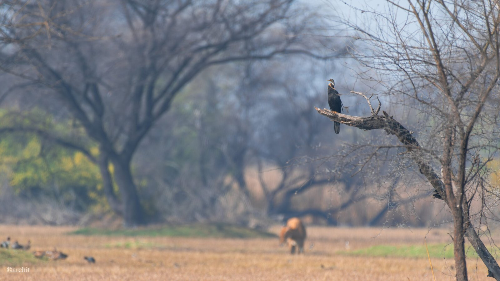

Credits: Archit Agrawal *(in frame: Darter (Snake Bird)*)

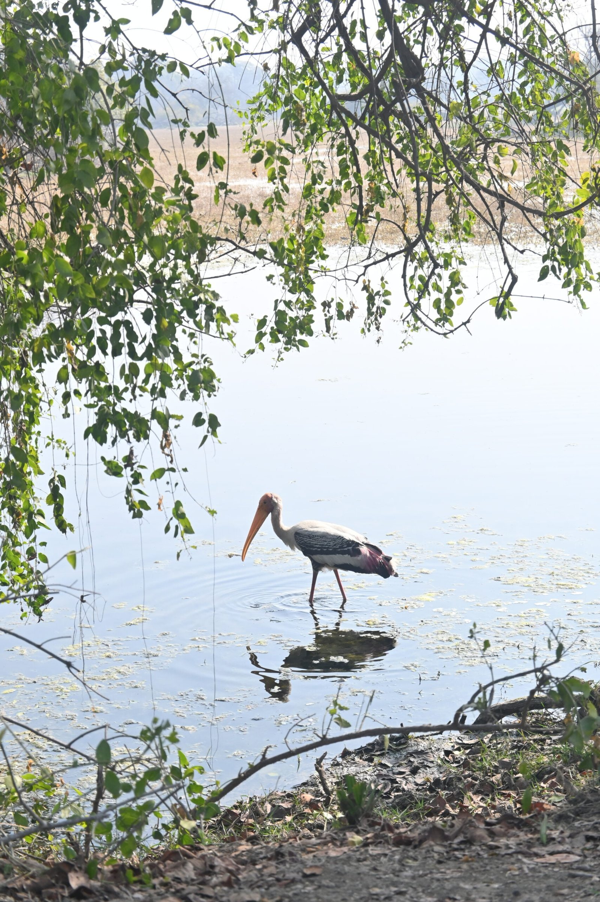

Credits: Gauri Shinde *(in frame: Painted stork)*

#### 2. **Flora:** Consists of dry deciduous forests, woodlands, grasslands, and wetlands. Key flora includes:

-   **Babul** *(Acacia nilotica)*
-   **Kadam** *(Neolamarckia cadamba)*
-   **Jamun** *(Syzygium cumini)*
-   **Kandi** *(Prosopis cineraria)*
-   **Ber** 
-   **Pilu** *(Salvadora persica)- a hardwood species, etc.*

Being a part of the Indo-Gangetic plains the wetlands are lush with aquatic vegetation, providing an ideal habitat for a variety of species.

#### 3\. **Fauna:**

-   **Spotted Deer** *(Chital)*
-   **Samba**r
-   **Nilgai** *(Blue Bull)*
-   **Jackals**
-   **Wild Boar, etc.**

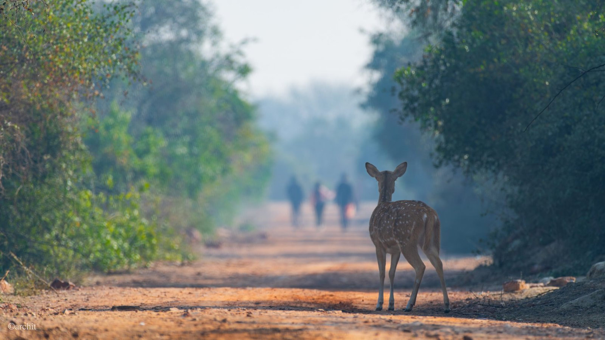

Credits: Archit Agrawal *(in frame: spotted deer)*

Reptiles include the **Indian Rock Python, Monitor Lizard,** and various species of turtles and snakes. The wetlands are teeming with amphibians like frogs and toads, shaping the park’s vibrant ecosystem.

My major highlights were seeing spotted deer, nilgai, sambhar, jackals, painted stork, common cormorant drying out his wings between a waterbody, northern pintail, Indian rock pythons, white Ibis, parakeets, etc.

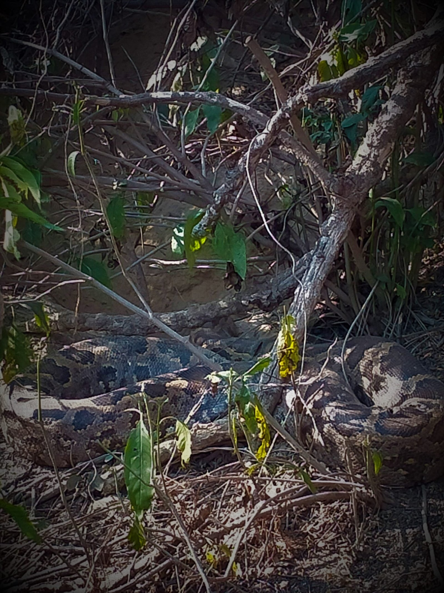

*(In frame: Indian rock python)*

### **HOW TO TRAVEL INSIDE FOR KEOLADEO NATIONAL PARK (SAFARI):**

Below mentioned photo specifies the rates for different modes of transport i.e. rickshaws, cycles, *tonga* (horse carriages) and boat rides one can use inside the park, including the entry fees for every individual.

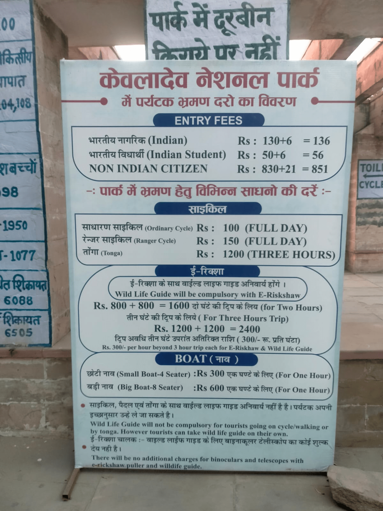

To conclude, this was my very first national park where I could see wildlife in such proximity. My very first walking safari! Strolling across the trails set by the forest dept., waiting to see birds at the horizon wanting me to see them in their element, their very own paradise.

Stay tuned with me, for more such adventures!

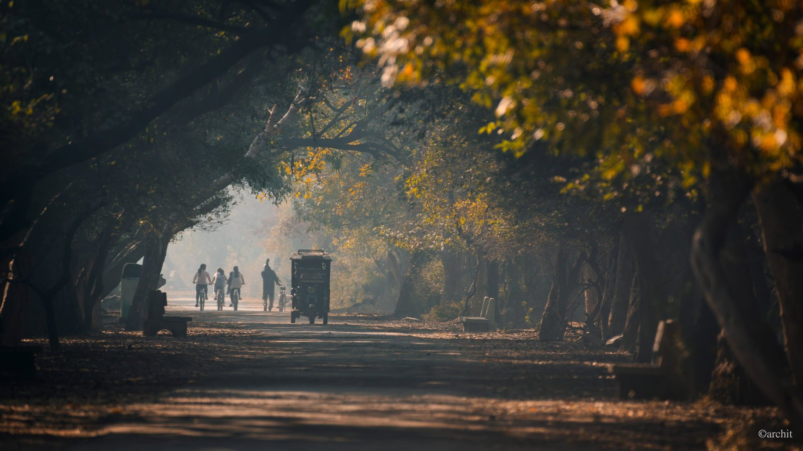

Credits: Archit Agrawal *(in frame: Keoladeo National Park)*

DoFollow: [https://www.instagram.com/wildtales\_by\_archit?igsh=bzcxY2tyOG0xN25p](https://www.instagram.com/wildtales_by_archit?igsh=bzcxY2tyOG0xN25p)

[https://gauritheexplorer.com/2-ethereal-days-of-haridwar-to-rishikesh/: Keoladeo National Park: Unforgettable for 46.7 million birdwatchers](/keoladeo-national-park-46-7-birdwatchers/) [https://gauritheexplorer.com/satpura-tiger-reserve-travel/: Keoladeo National Park: Unforgettable for 46.7 million birdwatchers](/keoladeo-national-park-46-7-birdwatchers/)

-   [Instagram](https://www.instagram.com/mi.tourist?igsh=MThpYzVnbTBoMm95ZQ==)
