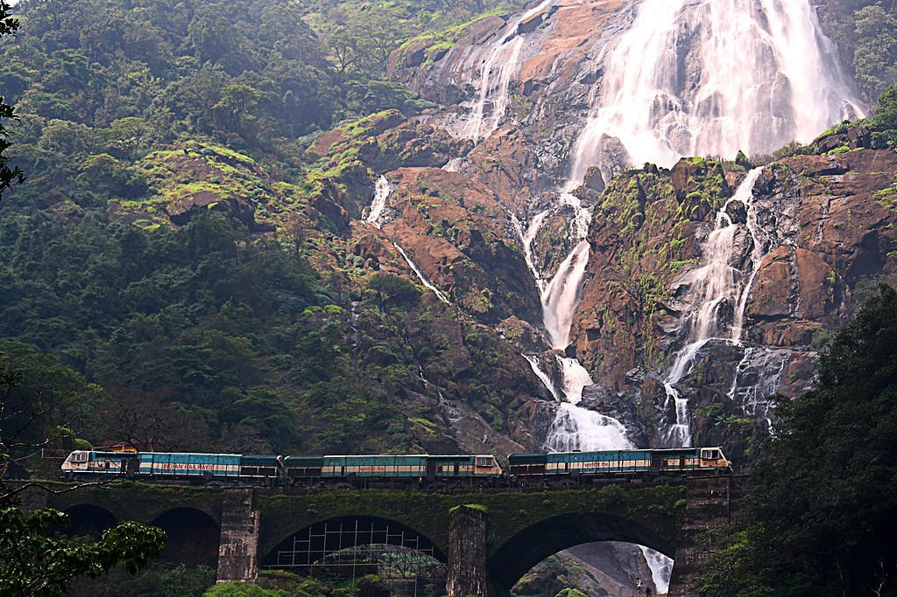
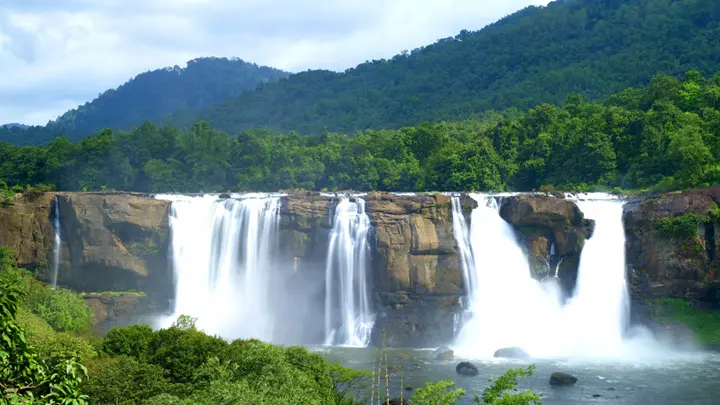
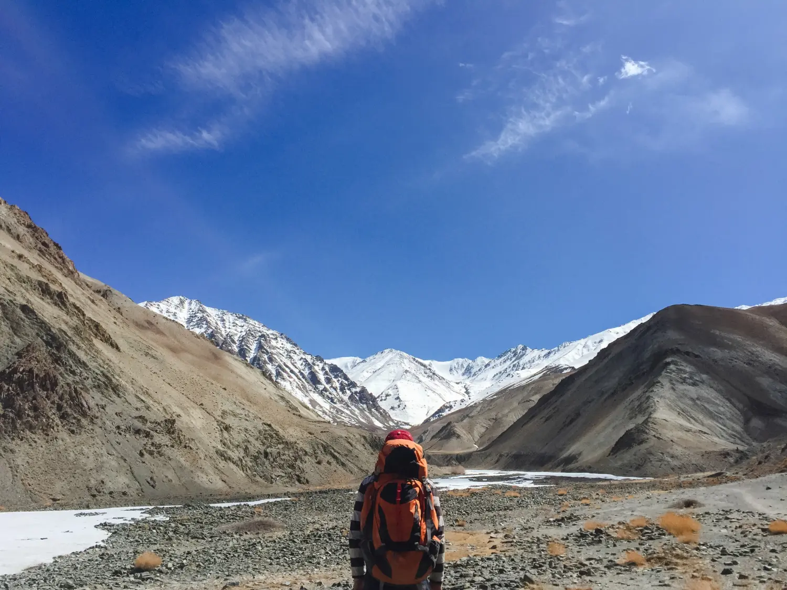
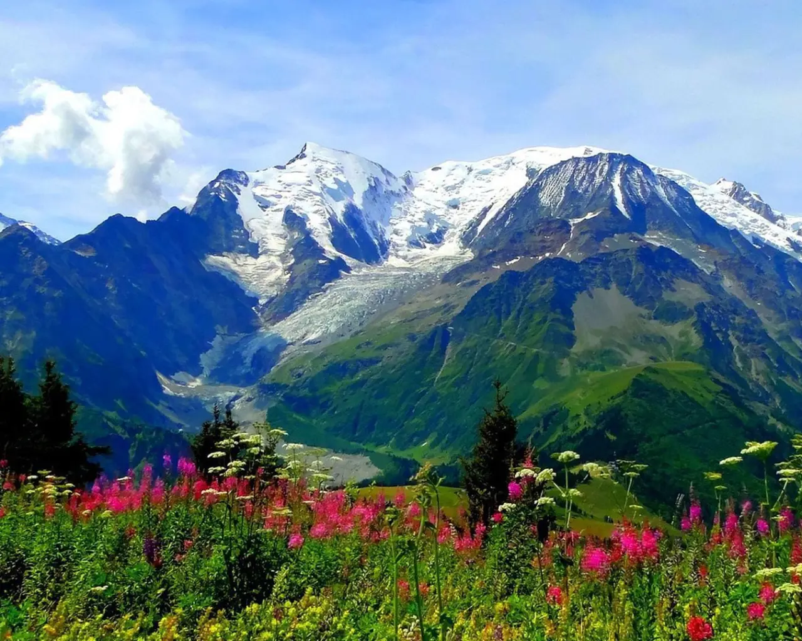
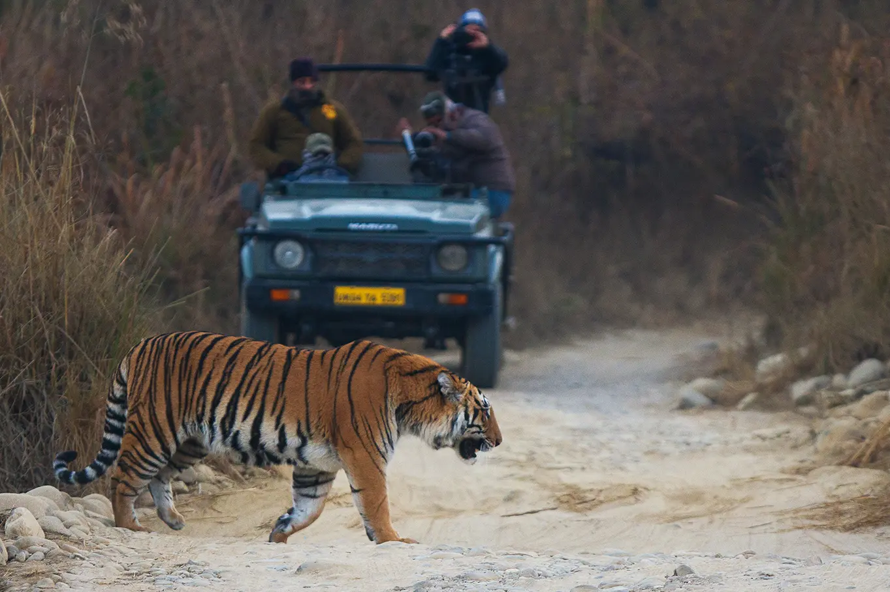
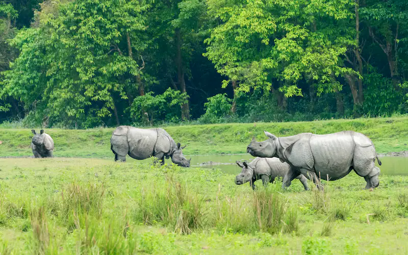
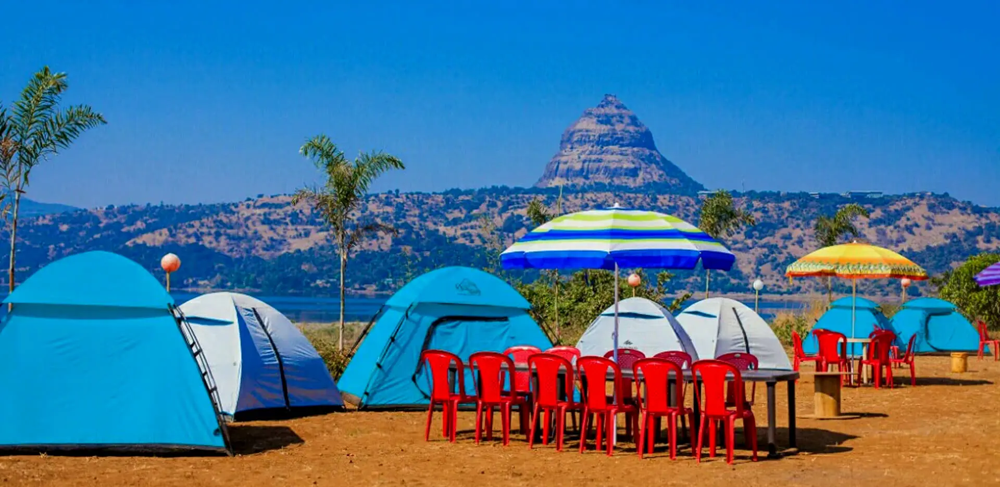
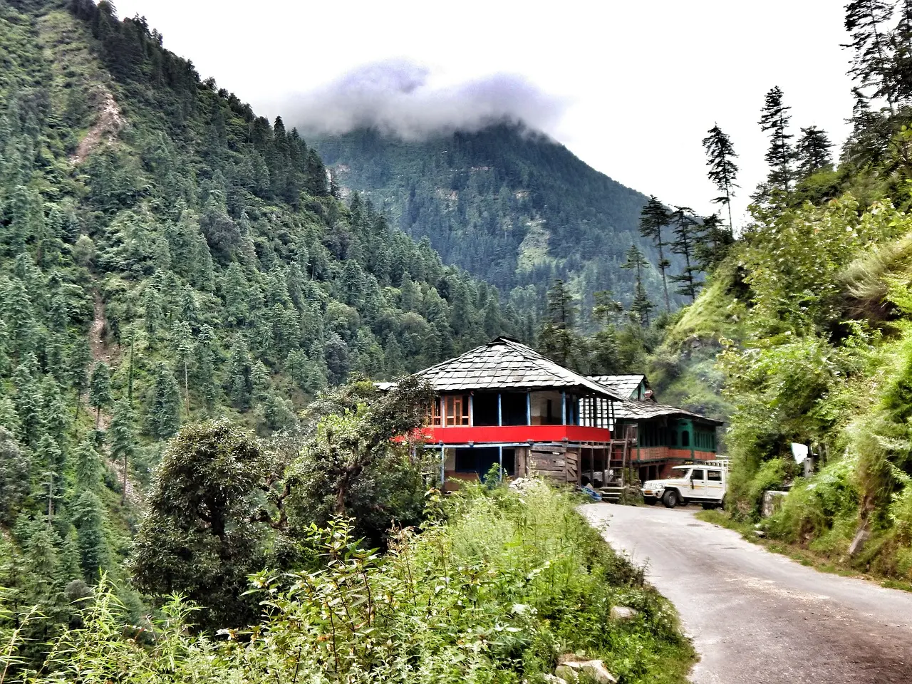

Are you ready for an exhilarating monsoon adventure with your friends? Look no further, as we unveil the 08 must-see places in India, perfect for a thrilling getaway during the rainy season. Get ready to witness the awe-inspiring beauty of two magnificent waterfalls, conquer two challenging hikes and treks, immerse yourself in the tranquillity of two national parks, and experience the joy of camping at two underrated destinations. Pack your bags, buckle up, and let’s embark on an unforgettable journey through **places to travel with your best friends this Monsoon India’s hidden gems!**

## **Dudhsagar Waterfalls, Goa-Karnataka Border:**

*Best Places to Travel with Your Friends this Monsoon*

“In nature’s majesty, Dudhsagar Waterfalls capture with their roaring grandeur, painting a picturesque landscape!”  
Significance: Dudhsagar, meaning “Sea of Milk,” is one of India’s tallest waterfalls. The cascading white water against the lush green backdrop creates a mesmerizing sight. Immerse yourself in nature’s splendor and feel the water spray on your face as you gaze at this majestic wonder!  
Best time to visit: July and September.  
Transport: Take a train from Goa or Karnataka to Kulem and then hike or hire a jeep to reach the waterfalls.  
Accommodation: Plenty of guesthouses and resorts near Mollem or Dudhsagar.

## **Athirapally Waterfalls, Kerala:**

*athirappalli-Athirapally-Waterfalls-Kerala*

“With its ethereal beauty, Athirapally Waterfalls invites you to embrace nature’s symphony, leaving you awe-inspired and rejuvenated!”  
Significance: Known as the “Niagara of India,” Athirapally Waterfalls is a feast for the eyes. The lush greenery, the thundering water cascade, and the serene surroundings make it an ideal spot to witness nature’s raw power during the monsoons. Athirapally is a village located in the Thrissur district of Kerala, India. It is situated on the Chalakudy River, which is a tributary of the Periyar River. The village is home to the Athirapally Waterfalls, which is one of the most popular tourist destinations in Kerala.  
Best time to visit: June to September.  
Transport: Approximately 55 km from Kochi, easily accessible by road.  
Accommodation: Resorts and homestays are available in Athirapally and nearby towns.

## **Roopkund Trek, Uttarakhand:**

*Roopkund Trek, Uttarakhand:*

photo by Freepik

“Roopkund Trek, where the mystique of a frozen lake and past tales merge, creating an unforgettable adventure!”  
Significance: Embark on an adventurous journey to the mysterious Roopkund Lake, also known as the “Skeleton Lake.” This high-altitude glacial lake, nestled amidst the breathtaking Himalayas, offers an unforgettable experience for trekkers. Brace yourself for stunning landscapes, alpine meadows, and a glimpse into ancient history as you encounter human skeletons dating back to the 9th century.  
Best time to visit: June to September.  
Transport: Reach Kathgodam by train from Delhi, followed by a drive to Lohajung, the starting point of the trek.  
Accommodation: Tents will be provided during the trek.

## **Valley of Flowers Trek, Uttarakhand:**

*Valley of Flowers Trek Uttarakhand*

“In the Valley of Flowers, nature unveils its hidden palette, painting a breathtaking picture that resonates deep within your soul!”  
Significance: Step into a paradise of vibrant blooms as you explore the Valley of Flowers. This UNESCO World Heritage Site, nestled in the Himalayas, boasts a diverse range of alpine flowers that come to life during the monsoons. Capture the beauty of rare Himalayan flora and create memories that last a lifetime!  
Best time to visit: July to September.  
Transport: Reach Govindghat by road from Rishikesh, followed by a trek to the Valley of Flowers.  
Accommodation: Basic guesthouses and tents are available in Ghangaria, the base camp for the trek.

### **Jim Corbett National Park, Uttarakhand:**

Bengal\_Tiger\_in\_Jim\_Corbett\_National\_Park”Jim Corbett National Park, where wilderness beckons, offers a rendezvous with nature’s untamed beauty!”  
Significance: Explore the oldest national park in India, renowned for its rich biodiversity and the majestic Bengal tiger. As you venture into Corbett’s dense jungles, keep your eyes peeled for diverse wildlife, including elephants, deer, and colorful bird species. Experience the thrill of a Jeep safari and feel the adrenaline rush through your veins! The Jim Corbett National Park, which is a part of the larger Corbett Tiger Reserve, is located in the Nainital district of Uttarakhand. It was established in 1936 as the Hailey National Park, making it India’s first national park. The park covers an area of 520 sq. km.  
The best time to visit: is June to October.  
Transport: The nearest airport is Pantnagar, followed by a drive to the park.  
Accommodation: Options ranging from luxury resorts to forest lodges are available.

## **Kaziranga National Park, Assam:**

*Kaziranga-National-Park-in-Assam*

“Kaziranga National Park, a realm where the rhinoceros reigns, beckons explorers to uncover the wonders of Assam’s wilderness!”  
Significance: Embark on an extraordinary journey to witness the iconic one-horned rhinoceros in its natural habitat. Kaziranga National Park is a UNESCO World Heritage Site and a wildlife lover’s paradise. Traverse the grasslands, marshes, and forests, and get up close and personal with the captivating wildlife that thrives in this magnificent landscape.  
The best time to visit: is July to September.  
Transport: Reach Guwahati by air or train, followed by a drive to Kaziranga.  
Accommodation: Resorts and lodges are available near the park.

### **Pawna Lake Camping, Maharashtra:**

*Pawana_Blue_Water_Camping*

“Pawna Lake Camping, where the stillness of the night and the shimmering reflections on the water create a paradise for weary souls!”  
Significance: Escape city life and immerse yourself in Pawna Lake’s serenity. Spend your nights stargazing, share stories around the campfire, and wake up to the mesmerizing views of the lake. Rejuvenate your soul amidst nature’s tranquility! Pawna Lake is a man-made reservoir located in the Indian state of Maharashtra. It was created in the early 1960s by damming the Pawna River. The lake is a popular tourist destination for its tranquility and scenic views.  
Best time to visit: June to September.  
Transport: Approximately 60 km from Pune and 110 km from Mumbai, easily accessible by road.  
Accommodation: Lakeside camping with tents and bonfire arrangements.

### **Tirthan Valley, Himachal Pradesh:**

*tirthan-valley-Himachal Pradesh*

“Tirthan Valley, a haven tucked away in the Himalayas, where time slows down, and nature whispers secrets that only wanderers can hear!”  
Significance: Indulge in the pristine beauty of Tirthan Valley, nestled in the Himalayas. This offbeat destination offers breathtaking views, sparkling rivers, and lush green meadows. Engage in adventure activities like trout fishing, river crossing, and hiking, or simply unwind amidst nature’s blissful embrace.

#### **The best time to visit: June to September.**

**Transport:** Reach Aut by road from Delhi or Chandigarh, followed by a short drive to Tirthan Valley.

**Accommodation:** Homestays, guesthouses, and campsites are available in the valley.

Discover the Best Places to Travel with Your Friend this Monsoon in India’s hidden gems with this comprehensive list of monsoon adventures! From awe-inspiring waterfalls and exhilarating hikes to enchanting national parks and serene camping sites, each destination promises to leave you spellbound. Let the rain-soaked landscapes and exploration thrill awaken the adventurer in you. Make this monsoon season a memorable chapter in your travel diary by packing your bags and bracing yourself for a memorable journey!

See also [https://gauritheexplorer.com/the-best-unique-bucket-list-travel-ideas/](/the-best-unique-bucket-list-travel-ideas/)
