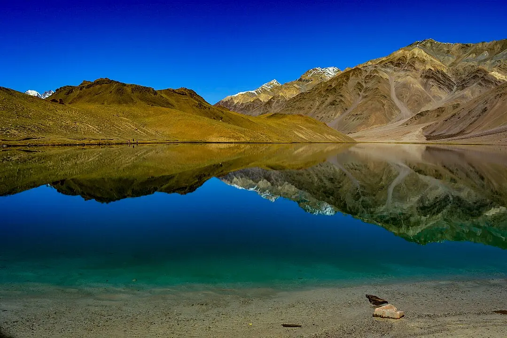

Are you tired of the same old travel destinations? Do you crave something truly unique and unforgettable? Look no further! In this blog post, we’ve handpicked the best unique bucket list travel ideas that are sure to leave you with memories to cherish for a lifetime. From exploring off-the-beaten-path gems to embarking on once-in-a-lifetime adventures, these travel ideas are not your typical tourist traps. So pack your bags and get ready for an unforgettable journey with our top picks for The Best Unique Bucket List Travel Ideas. Trust us, you won’t regret it!”

### Let’s See 10 The Best Unique Bucket List Travel Ideas

#### **1\. Spiti Valley, Himachal Pradesh:**

*The Best Unique Bucket List Travel Ideas spiti valli*

By Madhumita Das – Own work, CC BY-SA 4.0, https://commons.wikimedia.org

Venture into the mesmerizing cold desert of Spiti Valley, where snow-capped peaks, ancient monasteries, and vibrant Tibetan culture await. Capture the surreal beauty of landscapes and star-studded night skies that will leave you breathless.

#### **2\. Majuli, Assam:**

*The Best Unique Bucket List Travel Ideas Majali Assam*

image by – Carsten ten Brink for Flickr.com

Discover the world’s largest river island, Majuli, hidden in the heart of the Brahmaputra River. Embrace lush greenery, traditional art forms, and tranquil riverine life. It’s an ideal retreat for nature and culture lovers.

#### **3\. Dzukou Valley, Nagaland:**

Trek through the hidden gem of Dzukou Valley, nestled in Nagaland. The valley blooms with a kaleidoscope of wildflowers, making it a paradise for hikers and photographers.

#### **4\. Hampi, Karnataka:**

Step back in time at the UNESCO World Heritage Site of Hampi, an ancient city adorned with awe-inspiring ruins of temples and palaces. Unleash your inner archaeologist and capture history through your lens.

#### **5\. Chopta, Uttarakhand:**

Embark on a serene journey to Chopta, the “Mini Switzerland” of India, surrounded by beautiful Himalayan peaks. Trek to the picturesque Tungnath Temple and Chandrashila Peak for an Instagram-worthy vista.

#### **6\. Khajjiar, Himachal Pradesh:**

Nicknamed “The Mini Switzerland of India,” Khajjiar’s lush meadows and dense forests will leave you awestruck. Engage in adventure sports or revel in enchanting landscapes. 

#### **7\. Gandikota, Andhra Pradesh:**

Get ready to be mesmerized by the “Grand Canyon of India” – Gandikota. The dramatic gorge, carved by the Pennar River, presents a stunning panorama. Camping by the river is essential for a perfect Instagram shot.

#### **8\. Gurez Valley, Jammu & Kashmir:**

Escape to the lesser-known paradise of Gurez Valley, surrounded by snow-capped peaks and crystal-clear rivers. This hidden gem is perfect for photographers seeking untouched natural beauty.

#### **9\. Ziro Valley, Arunachal Pradesh:**

Experience the tranquility of Ziro Valley, home to the unique Apatani tribe and their intriguing paddy-cum-fish farming. The vibrant tribal festivals and breathtaking landscapes will enrich your Instagram feed.

#### **10\. Binsar, Uttarakhand:**

Seek solace in Binsar’s serene forests, offering breathtaking views of Nanda Devi, Panchachuli, and other peaks. Explore the Binsar Wildlife Sanctuary for rare flora and fauna encounters.

In conclusion, the world is full of unforgettable travel destinations just waiting to be discovered. Whether you’re looking for adventure, relaxation, or something in between, the best unique bucket list travel ideas have got you covered. So why stick to the same old tourist traps when you can experience something truly unique? Pack your bags and get ready for an adventure you’ll never forget with our top picks for The Best Unique Bucket List Travel Ideas. Trust us, you won’t regret it! Happy travels!”
