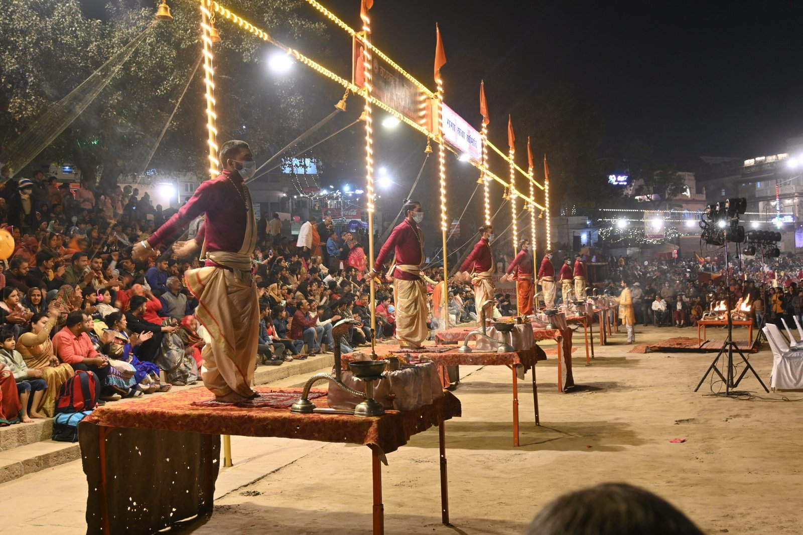
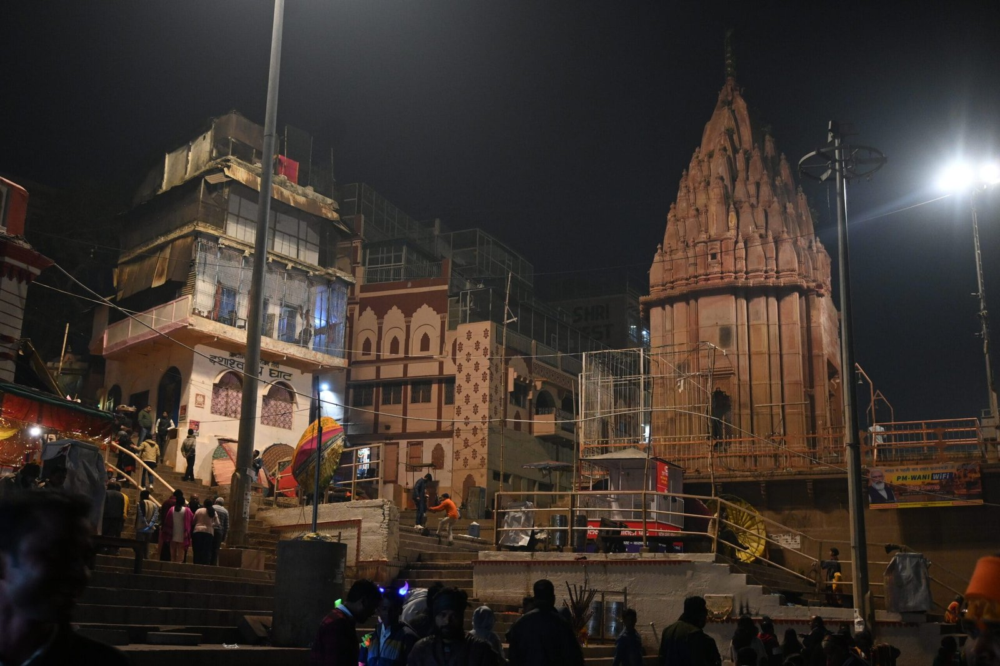
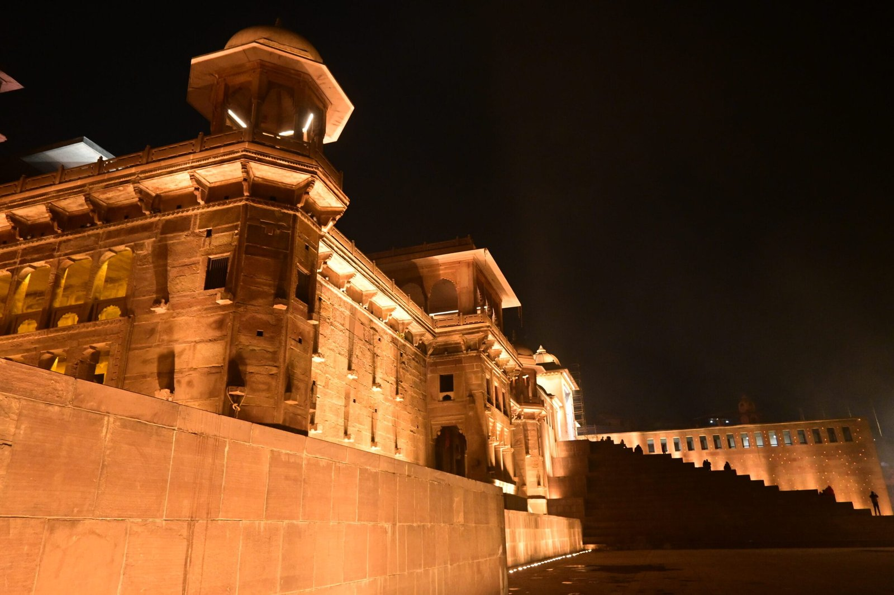
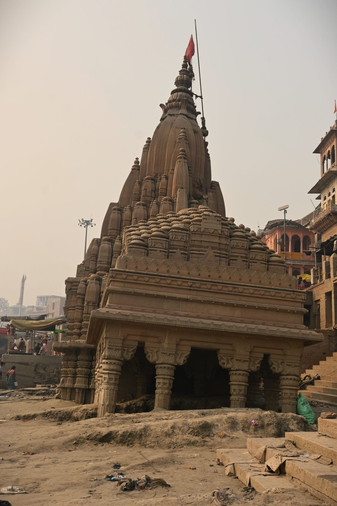
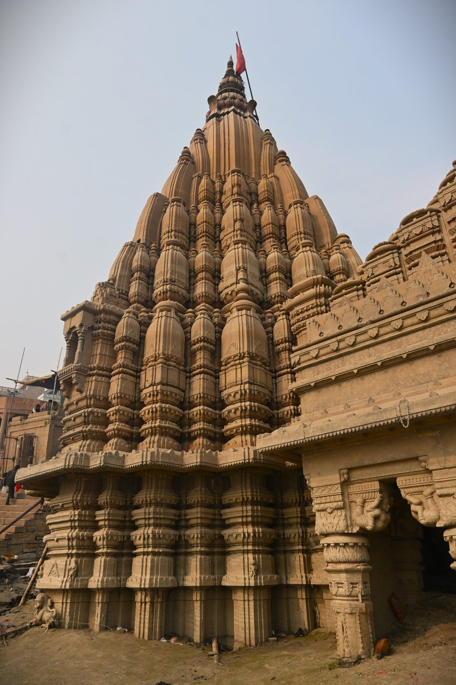
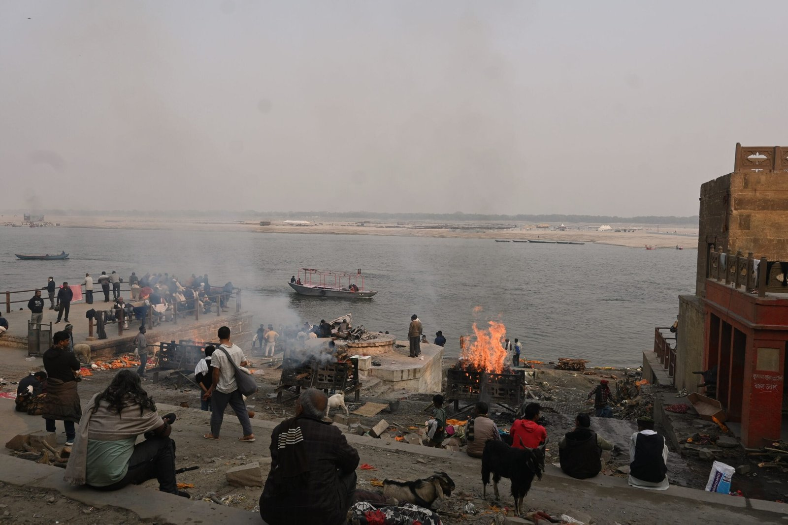

।। अविमुक्तेश्वरम् हि यत्र सन्ति नरः सदा:
तत् काशी भविता नित्यं, शिवेन सह मोदिनी।।

(*Kashi is the eternal city where Shiva Himself resides, granting liberation to all who seek Him.*)

Begin Your Ultimate Spiritual Journey in **Varanasi**! Lord Shiva’s classic favorite, where he’s called **Vishwanath**, the sole protector of the entire world. This ancient civilization across the western banks of the sacred river Ganges, known as Kashi, Banaras, and Varanasi, bears many names, but for me, it evokes a single transcendent emotion—that feeling of being beyond the usual, with a sense of awe and reverence.

The most interesting part of this trip was that it was unplanned. I had a winter break at my college for a week and my batchmates were traveling to different places across India. On the contrary, I was planning on sleeping and binge-watching my favorite shows. Little did I know that my friend’s impulsive decision would bring so much adventure and meaning to my life.

##### **22 Dec 2022, Gwalior-Varanasi**

I packed my backpack and boarded *Bundelkhand Express* from Gwalior which I almost missed because I was late to reach the train station. Student life is meant for experimenting thus my friends *Anjali, Mayank, Nishant, and Swapnil* got into the general compartment for a *14-hour-long* journey.

However, the twist in the story comes when *Anjali & Swapnil* suddenly decide to go to Rameswaram instead of Banaras, when the train stops at Jhansi junction. They deboard there, and we say our goodbyes, wishing them luck for another *51-hour* journey down south. Later, the rest of us shifted to 3 AC compartments for the rest of the night after knowing, that some of our juniors were traveling back home, for the winter break. With a lot of laughter, struggle to get seats, exhaustion, and missing dinner we got some sleep and were finally ready to see Kashi’s charm in the morning by 11 o’clock.

##### **23 Dec 2022, Varanasi**

With little to no budget of Rs. 2,500/- per person, Banaras welcomed us with open arms. We had no idea where to stay for the next 2-3 days, so one of our juniors from Varanasi helped us with getting dorms near Jain Ghat. Post exploring the nearby area we had brunch and took some rest to get ready for our evening tour of beautiful ghats and witness the magical evening **Ganga Aarti** of **Assi Ghat.** I decided to see Kashi on foot to understand it better. It was five in the evening already and well  I was ready to see the entire trail of ghats for the rest of the night.

##### **Assi Ghat- Ganga Aarti**

My first stop was **Assi Ghat**, so I walked down from Jain Ghat to Assi to attend the Ganga Aarti. Coming from **Maharashtra**, witnessing the Ganga Aarti for the first time was nothing short of sublime. The synchronized movements of the priests, the golden flames dancing against the night sky, and the soulful hymns created an ethereal spectacle. It wasn’t just a ritual; it was an awakening, a moment where time seemed to dissolve into devotion. The Ganges didn’t just flow—it resonated, embraced, and sanctified.

*Ganga Aarti, Assi Ghat, Varanasi*

##### **Food Tour**

On the contrary to its spiritual side, Banaras is equally popular for its local cuisine. And on that note, after saying my prayers and capturing a few photos & videos, I was ready to discover the typical *Varanasi Chaat!* 

I headed towards the local street vendors to savor legendary flavors. My food tour began with the sweet n‘ sour *Bhelpuri*, followed by the irresistible *Samosa Chaat, Tomato Chaat,* and the golden-crispy *Aloo Tikki*. The famed *Malaiyo*, a heavenly cloud of saffron-infused sweetness, melted in my mouth, while the “*Pehelwan Lassi*” offered a rich and velvety respite. As a fitting finale, I indulged in a classic *Banarasi Paan*, the aromatic blend of betel leaves & spices leaving a lingering taste of tradition and nostalgia.

##### **Walking Tour**

*Dashashwamedh Ghat, Varanasi*

I wandered through major ghats out of 84 like—**Dashashwamedh, Manikarnika, Assi, Harishchandra, Hanuman, Ahilyabai, and Scindia Ghats**— feeling the spirit of this ancient city. At **Dashashwamedh Ghat**, I paused for a cup of **lemon tea**, letting its warmth settle within me. There, I met two **yogis**, mysterious yet serene, who placed a Rudraksha in my palm—a silent blessing, a sign of their world beyond attachments.

Moving forward, I saw the glowing corridor of **Kashi Vishwanath**, one of the **12 Jyotirlingas**, shining like a beacon of faith, its radiance filling the narrow alleys with divine light. When I almost reached **Manikarnika Ghat**, I also got the opportunity to be a part of  Aarti at another Shiv temple the sound of which echoed in the air, the deep toll of huge bells and rhythmic beats of damru created an aura of devotion.

The moment my footsteps carried me to Manikarnika ghat, it caught my attention. I witnessed the eternal flames of cremation burned a sight that sent chills through me. Watching the pyres, I felt the weight of existence, the undeniable truth of life and death. I sat there in silence, absorbing the moment. Life felt fleeting, yet this city stood timeless—a place where seekers, sages, and wanderers come to understand what lies beyond.

##### **24 Dec 2022,** **Heritage Tour**

*Kashi Vishwanath Corridor*

I got up early in the morning to visit 3 major temples one has to visit i.e. the Kashi Vishwanath temple, the Kal Bhairav temple *(guardian of Kashi)*, and the Annapurna temple. Vishwanath temple is a gateway to liberation (*moksha*), where the divine essence of **Lord Shiva** is believed to be ever-present. Its origins trace back to ancient times, with references in sacred texts like the **Skanda Purana** and **Shiv Purana**.

Historically, it was rebuilt multiple times due to invasions until **1780**, **when Queen Ahilyabai Holkar** rebuilt the current structure, reinstating its glory. It reflects the elegance of **Nagara-style architecture**, with intricate carvings and a **15.5 m**. **golden shikhara,** donated by **Maharaja Ranjit Singh** in **1835**, devotees believe that a single darshan of Vishwanath washes away lifetimes of karma. Legend has it that, the **Gyanvapi Well** adjacent to the temple is said to contain the original **Shivling** hidden during invasions.

##### **Ratneshwar Mahadev Temple**

Later on, I visited the *“Leaning temple of India”* Ratneshwar temple, near Manikarnika Ghat. If you’re wondering why it is tilted? Here’s the answer: Few believe that the temple was built by a devoted servant for his mother, but upon completion, a curse rendered it imperfect—hence, its distinct tilt, while others claim that **King Man Singh of Jaipur** or local merchants commissioned its construction in the 19th century. The temple’s foundation, built on the riverbed, has resulted in its dramatic **5-degree tilt**, making it one of the most unique structures in Varanasi. We can’t be certain…

*Ratneshwar Temple, Varanasi*

*Ratneshwar Temple, Varanasi*

##### **Tulsi Ghat, Tulsidas Ji’s Residence**

I also paid visit to Goswami Tulsidas residence and Tulsi Ghat precisely, where Goswami Tulsidas wrote the classic Ramcharitmanas, pilgrims and scholars alike visit this revered site, drawn by the deep spiritual connection it holds. It is home to rare manuscripts, a wooden writing desk, and relics associated with the poet. It is said that Hanuman himself blessed Tulsidas at this very place, inspiring him to write the immortal epic.

##### **Harishchandra Ghat**

I visited the **Harishchandra Ghat,** one of Varanasi’s oldest and most sacred ghats, is a revered cremation site believed to grant **moksha (liberation)** to departed souls. Named after **King Harishchandra**, who, as per legend, worked here as a cremator to uphold truth and dharma and the presence of male goats were said to be the helpers of king Harishchandra that helped him with cremation, symbolizing sacrifice and righteousness. **Raja Man Singh of Jaipur** and later the **Marathas** contributed to its restoration. Unlike Manikarnika Ghat, it is less crowded but equally significant. The flames here burn ceaselessly, marking the cycle of life and death.

*Harishchandra Ghat*

##### **Inbound Tourists & Vloggers**

The foreign tourist traffic in Banaras is fairly higher than other places in India making it popular worldwide. Post lunch, I was wandering around the ghats, where I met 2 Russian friends, one of them named Arthur, we started speaking randomly but I ended up narrating few stories about Varanasi fueling their curiosity. I also saw some South Korean **vloggers** on my way back, making me realize that Varanasi isn’t just a city; it draws seekers from everywhere. Watching them capture the essence of the ghats, I felt proud that this ancient city, with its tales of life and liberation, continues to enchant souls across continents.

As Shankaracharya says in Kashi Panchakam,

काश्यां हि काशते काशी सर्वप्रकाशिका।

सा काशी विदिता येन तेन प्राप्ता ही काशिका।।

*(The light of self-realization makes Kashi radiant; it illuminates all things. Whoever understands this eternal truth attains oneness with Kashi)*

Varanasi is not just a destination; it is an experience, a revelation, a passage between the earthly and the divine. From the sacred ghats to the timeless chants, every step in this city echoes with spiritual awakening. As I left Kashi, I carried its essence within a reminder that some journeys never truly end, they stay with you forever. Varanasi, where every step echoes with the whispers of divinity.

Here, the soul finds its true home.

*See you around with another experience, stay tuned!*

Read more: [https://gauritheexplorer.com/2-ethereal-days-of-haridwar-to-rishikesh/](/2-ethereal-days-of-haridwar-to-rishikesh/)

DoFollow: [https://www.instagram.com/mi.tourist?igsh=MThpYzVnbTBoMm95ZQ%3D%3D&utm\_source=qr](https://www.instagram.com/mi.tourist?igsh=MThpYzVnbTBoMm95ZQ%3D%3D&utm_source=qr)
