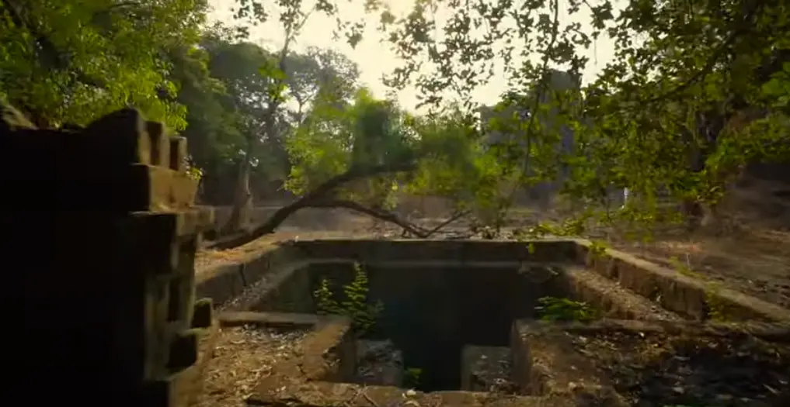
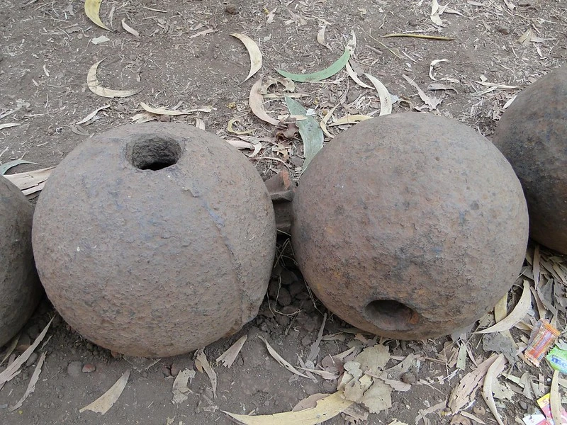
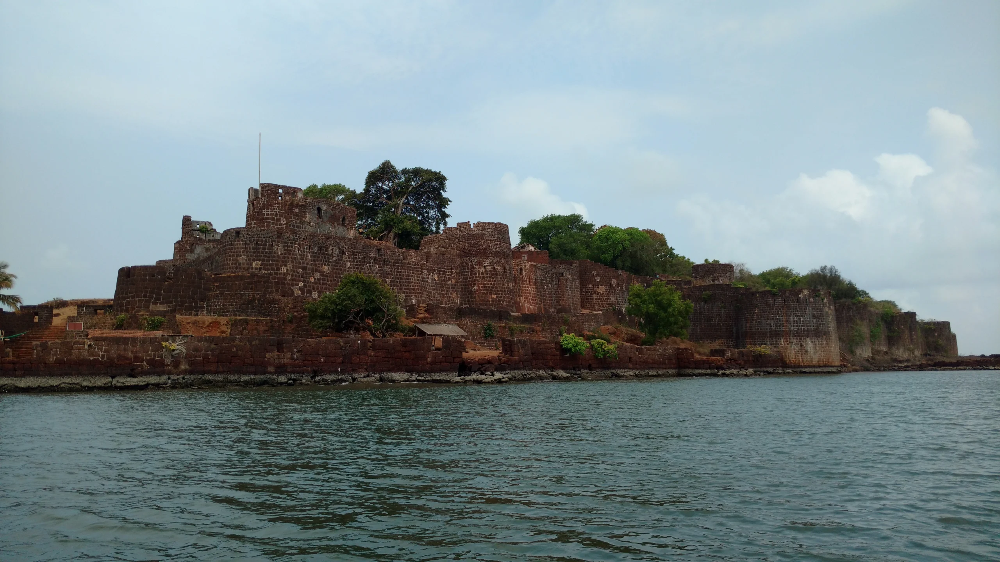

Hello Everyone! Today, I would like to share with you my enchanting experience at the **Fort** of the Konkan Sea, **Vijaydurg: A Victorious Sea Fort!** Located in Sindhudurg district, Maharashtra, India. It is situated on the coast of the **Arabian Sea**. Its original name was “**Gheria**” but after being captured by Shivaji Maharaj from the Adil Shahi Dynasty of Bijapur and renamed it “**Vijaydurg**“. Accompanied by a bright sun, our family and friends, and some good music along the way. The first time that I visited this place was on May 12, 2018.

The scenic beauty of the fort resembling a necklace to the sea mesmerized me the second I saw it. The gigantic structure is surrounded by blue water on three sides with its own shimmering waves similar to the pearls adding value to this necklace.

First of all, it’s necessary to hire a tour guide, so that one can get all the essential information about the geography and architecture of the fort. From climbing those huge stairs to visiting town hall to the king’s central court, I learned how futuristic and brave our kings were.

Thereafter, you can pay a visit to the queen’s bathtubs, the Vrindavan where they worshipped the herbal plant called “tulsi”,

*The queen’s bathtubs*

even the basements where the grains and ammunition were stored are a sight worth observing. Moreover, the types of cannons are very unique. Worth appreciation!

*Vijaydurg: A Victorious Sea Fort!*

Later, the guide will also take you to the mysterious tunnels and the emergency exits used by kings. In addition, you can have a mini-tour of the area where the soldiers were trained and gained expertise in guerrilla warfare taught by Chhat. Shivaji Maharaj. You will also get the opportunity to visit a small Hanuman temple as well as a temple of goddess.

Besides, I wish to tell you that this visit taught me a lot. About history, the lifestyle of medieval times, the principles of our great kings, their vision about the bright future, their philosophies, and also the art and science of life. History is not just dates and events from the past.

*Vijaydurg: A Victorious Sea Fort!*

This is what we keep, for the whole life so that we will not make the same mistakes in the future and live our lives with values. Lastly, I wish to assure you you’ll get a lot of insights and learn certain fun facts about kings and their untold stories that you won’t read in your textbooks. So, don’t forget to visit this Vijaydurg killa.

Tell me if this is interesting for you or not. Please leave me your comments!

**Q&A**

###### **Q what transport modes are available for Vijay Durg Fort?**

Ans.

By Road – From Cities like Mumbai, Pune, and Kolhapur for Vijaydurg Fort you can book rental private buses, cars, or taxis because road connectivity is very good for Vijay durg fort’s

By Railways – Kudal railway station is near Vijay Durg Fort it’s just 50 KM away. you can get taxis or rental cars or public-private buses available

By Air – Dabolim Airport, Goa’s nearest airport to Vijay Durg Fort it’s just 145 Km away you can book rental cars, or public buses are also available

###### **Q What are popular attractions near Vijaydurg Fort?**

Ans-

**Malvan Beach** – is one of the most popular beaches and is located only 10km away from the Vijay Durg fort where you can find clean water with white sand and also enjoy Swimming Sunbathing, and water sports

**Devgad Beach** – 40 km away from Fort and it is well known as a quiet and peaceful beach. But the most interesting thing is Devgad village is world-famous for its pure Alfonso mangos cultivating/farming called “hapus” its exported all over the world

**Rameshwar Temple** – A dedicated Loard Shivaj’s ancient temple is situated in a village called Achara near the fort. It is famous for its unique ancient architecture
